# AuthKademlia-RS design

This document explains how AuthKademlia-RS works and why: what a node stores,
how records are published, read and rotated, and what each choice defends
against. It describes the protocol, not the API: see `README.md` for usage,
`docs/integration.md` for what an application must do, and `AGENTS.md` for
the code map. The diagrams are PNG images drawn from the Mermaid sources in
`docs/design/` (`*.mmd`), so that they show where Mermaid is not drawn, as in
the GitHub mobile app.

## Contents

1. [Purpose and architecture](#1-purpose-and-architecture)
2. [Threat model and security properties](#2-threat-model-and-security-properties)
3. [Identifiers, records and the tree of keys](#3-identifiers-records-and-the-tree-of-keys)
4. [Transport](#4-transport)
5. [Routing](#5-routing)
6. [Publication (SET)](#6-publication-set)
7. [Storing at a replica (STORE)](#7-storing-at-a-replica-store)
8. [Reading (GET)](#8-reading-get)
9. [Key rotation](#9-key-rotation)
10. [Status List](#10-status-list)
11. [Replication, churn and expiry](#11-replication-churn-and-expiry)
12. [Concurrency and resource bounds](#12-concurrency-and-resource-bounds)
13. [Known limits](#13-known-limits)
14. [How behaviour is measured](#14-how-behaviour-is-measured)
15. [References](#15-references)

## 1. Purpose and architecture

AuthKademlia is the Verifiable Data Registry (VDR) of the `did:iiot` method
[Trungadi 2025]. It stores two kinds of records: DID Documents, which hold a
device's post-quantum public key (ML-DSA-65 [FIPS 204]), and the Status List
of revoked credentials, signed by an issuer.

The DHT is Kademlia [Maymounkov 2002] with one change that shapes everything
else: **a node stores a value only if it is an authenticated record**, a DID
Document signed by a key its DID commits to, or the Status List signed by the
issuer.

### Architecture

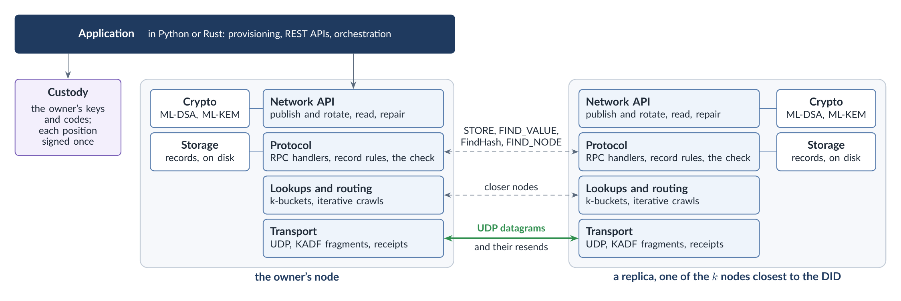

*Source: [`docs/design/architecture.mmd`](docs/design/architecture.mmd).*

A node is one Rust process; the application above it, in Python through the
PyO3 binding or in Rust, decides what to publish and when.

| Component | Role | Section |
|---|---|---|
| Network API | Publication of any position, reads and repairs, the Status List; hourly refresh and republication, maintenance of contacts | 6, 8, 10, 11 |
| Protocol | The RPC handlers; the rules a replica applies to a record; the network check of an empty replica | 7 |
| Lookups and routing | Kademlia's k-buckets and iterative lookups | 5 |
| Transport | UDP datagrams, fragments of large records, receipts and resends | 4 |
| Crypto | ML-DSA-65 signatures of records; ephemeral ML-KEM-768 key pairs for the application | 3 |
| Storage | Records with a 14-day TTL and a byte budget; a cache of signature verifications | 3, 12 |

The Python binding releases the GIL before entering Rust, so signature
verifications, which are CPU-bound, run on every core while the application
stays in Python.

## 2. Threat model and security properties

The DHT must hold up against:

- **A network attacker** who reads all traffic and sends packets of its own,
  from as many ports as it likes, next to any node. In the testbed this
  attacker cannot modify or drop the owner's packets. If it could, it would
  still not forge a signature, but it could deny service.
- **Malicious nodes** that answer requests with anything, or not at all,
  under as many made-up ids as they like.
- **Forged records**: anyone can generate a key pair and sign a document that
  claims a DID. It is refused everywhere, since the DID commits to every key
  that may sign for it (section 3).
- **Replayed records**: anyone can resend a genuine record the owner has
  since superseded.

Out of scope for the DHT, by design:

- **Who owns a DID.** The binding between a DID and a device is the
  Verifiable Credential: the application compares the public key in the DID
  Document with the key in the VC (section 8).
- **An attacker who controls every node close to a DID.** It cannot forge a
  record, but it decides which of the owner's records, if any, that DID
  resolves to. Kademlia's defences against such eclipse attacks (many
  disjoint lookups, costly node ids) are not implemented.

The DID is the hash of a genesis that commits the first document and the
root of a Merkle tree of 64 keys, one per position (ADR 0006). It stays the
same across rotations, nobody can write a document for another device's DID,
and each position carries the proof of its own key: a replica needs nothing
published before it. The keys of later positions are committed but not
exposed until used, as KERI's pre-rotated keys held in reserve [KERI].

### Security properties

Each property, the mechanism that provides it, and what it rests on:

| Property | Mechanism | Holds while | Section |
|---|---|---|---|
| **Authenticity** of a record: the owner signed it | The key of its position reaches the root its DID commits to, and the ML-DSA-65 signature verifies; every node checks both before storing or returning a record | SHA-256 resists collisions and second preimages; ML-DSA-65 is unbroken | 3 |
| **Control** of a DID: only its owner can publish a position | The key and activation code of each position are committed in the tree; the code stays private until the position is published | The seeds and codes of unpublished positions stay secret | 3, 9 |
| **Order**: a lower position does not replace a higher one | `seq` at a replica that holds the DID; at an empty one, a higher record that a node shows | At an empty replica, one holder of the higher position answers in time | 7 |
| **Answers** come from the nodes asked | Message ids drawn at random, matched with the source address | The attacker cannot read the traffic | 4 |
| **Availability** of a record | `k` replicas; republication by the holders and by the owner | One holder, or the owner, is online | 11, 13 |
| **Bounded resources** under load | Storage budget, bounded reassembly, bounded queues, lookups and fetches | | 4, 7, 12 |
| **Post-quantum** security | ML-DSA-65 for records; key agreement by ephemeral ML-KEM-768, outside the DHT | | 3 |

Not provided: that a record read is the owner's current one, or that the
device behind the DID is the one expected. The application compares the
public key with the key in the Verifiable Credential (section 8).

## 3. Identifiers, records and the tree of keys

| Item | Definition |
|---|---|
| Node id | 256 bits. Distance is the XOR of the full 256 bits, never folded |
| DID | `did:iiot:` and the base64url, without padding (43 characters), of the SHA-256 of the canonical genesis (below) |
| DHT key of a DID | The DID's suffix, decoded: the 32 bytes of that hash |
| DHT key of the Status List | `SHA-256("status-list")` |
| Record | `algorithm (12 B) | signature | DID Document (canonical JSON)` |

The algorithm field must be `ML-DSA-65` (ADR 0003): a record with any other
is refused, so no DID is published with a key a quantum computer breaks. The
signature is pure ML-DSA with an empty context, 3309 bytes. The document has
one key, a JWK of the type RFC 9964 defines [RFC 9964]: `{"kty": "AKP",
"alg": "ML-DSA-65", "pub": <base64url>}`.

Documents are in a canonical form, so that one document has one hash:
printable ASCII only, integers within ±(2^53 − 1) without fraction or
exponent, sorted keys and no whitespace, and the bytes must equal their
re-serialization.

### The tree and the genesis

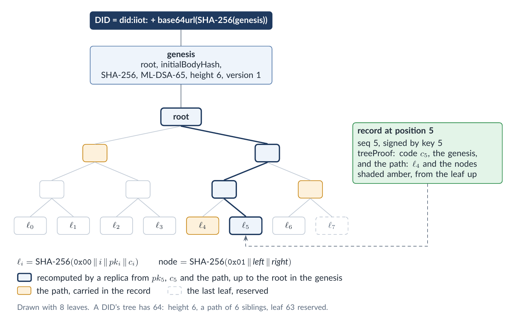

*Source: [`docs/design/key-tree.mmd`](docs/design/key-tree.mmd).*

At provisioning the owner generates, for each of 64 positions, an ML-DSA-65
key pair from a 32-byte seed and an independent random 32-byte activation
code. Leaf `i` is SHA-256(`0x00` ‖ `i` as 4 bytes big-endian ‖ raw public
key ‖ code), and an internal node SHA-256(`0x01` ‖ left ‖ right): the two
prefixes keep a leaf from being read as a node, as in Certificate
Transparency [RFC 9162, §2.1.1], and the index is written as LMS writes its
leaf number [RFC 8554, §5.4]. Positions 0 to 62 sign documents; 63 is
reserved. A record carries its position and path as an XMSS or LMS
signature carries its leaf index and authentication path [RFC 8391]
[RFC 8554], but each leaf holds a many-time ML-DSA-65 key, not a one-time
key.

The genesis is a JSON object of exactly six members: `hashAlg` `"SHA-256"`,
`height` 6, `initialBodyHash`, `root`, `sigAlg` `"ML-DSA-65"` and `version`
1. Its canonical bytes hash to the DID. `initialBodyHash` is the SHA-256 of
the **body** of position 0: its document without `id` and `treeProof`, with
its own DID written as the placeholder `did:iiot:self` wherever a string
value is the DID or a DID URL of it (`#`, `?` or `/` after it). The owner
writes that body before the DID exists, and the DID then fixes it. A signed
document that holds the placeholder is refused, so the body cannot be
ambiguous.

Every document carries:

- `seq`: its position, the index of its leaf, from 0 to 62;
- `prev`: absent at 0; after it, the base64url SHA-256 of the record the
  owner published before. Only its form is checked: positions need not
  follow each other, and no replica needs that record;
- `treeProof`: exactly `code`, the activation code of the position, `genesis`
  and `path`, the six siblings from the leaf's up to the one below the root
  (192 bytes). Bit `i` of `seq` is 1 when the node at level `i` is a right
  child.

A record is accepted for a key only if:

1. **Form and tree:** the document is canonical and holds no placeholder;
   its `id` is a DID whose suffix is canonical (it encodes back to itself,
   so one DID is one key) and decodes to the key; `seq` is from 0 to 62;
   `prev` is absent at 0 and well formed after; the genesis has its six
   fixed members and hashes to the key; the leaf of the document's key and
   code at `seq` reaches the genesis root through the path; and at position
   0 the body hashes to `initialBodyHash`. No signature is verified yet.
2. **Signature:** the document's key has `kty` `AKP` and the `alg` of the
   record's algorithm field, and the signature verifies over the canonical
   JSON with that key, which step 1 tied to the DID.

A verification result can be cached under the SHA-256 of the record (one hour,
4096 entries). A cache miss is a full verification, never a bypass.

**Why an activation code.** A leaked private key of a position not yet
published is useless without that position's code, which the owner never
releases: the owner skips that position for good. A code becomes public with
the record of its position, so it guards a position only until then.

### Creating a DID

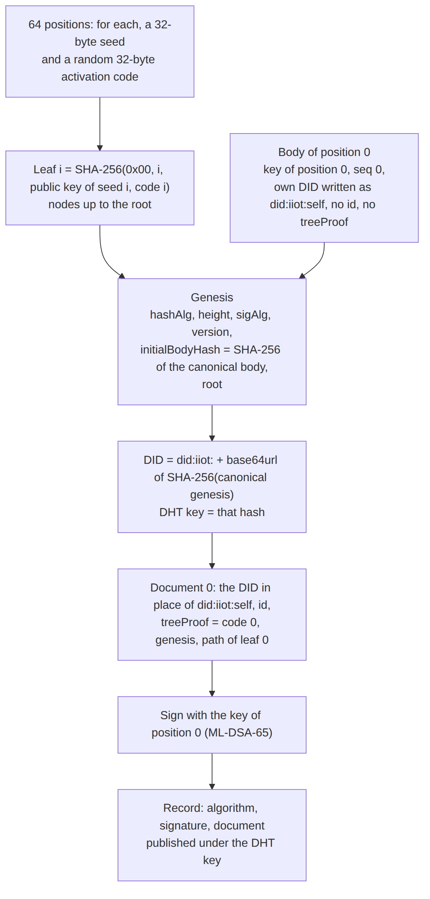

*Source: [`docs/design/did-creation.mmd`](docs/design/did-creation.mmd).*

A device creates its DID once, before publishing anything: it builds its
tree, writes the body of position 0 with `did:iiot:self` in place of its own
DID, and hashes the genesis of the two. The hash is both the DID and the DHT
key. It then writes the DID into the document, adds `id` and the `treeProof`
of position 0, signs it with the key of position 0, and publishes it with SET
(section 6). The library's custody does all of it (section 9).

## 4. Transport

Nodes talk over UDP. A message is a `bincode` envelope
`(message id, is request, message)`. Requests and answers are matched by
message id and by the peer's address, and an answer of the wrong type is
discarded. Each request draws its message id at random, never one a pending
request holds, so a node that does not read the traffic cannot answer in
another node's place: an answer counts only if its id is pending for the
address it comes from.

Post-quantum records are about 7 KB, more than one datagram, so every message
is split into fragments of at most 1400 bytes with a 12-byte header (`KADF`,
fragment id, index, total). Reassembly is bounded: at most 256 KB per message,
64 partial messages in all, 8 per peer, kept 10 s. These limits protect memory.
They also mean that a node receiving many large answers from the same peer at
once drops some: section 7 explains why the STORE check asks for hashes.

| Request | Answer | Purpose |
|---|---|---|
| `Ping` | `Pong` | Liveness and discovery |
| `FindNode` | `FindNodeResult` | The closest nodes to a key |
| `FindValue` | `FindValueHit` or `FindValueNodes` | A record, or closer nodes |
| `FindHash` | `FindHashHit` or `FindValueNodes` | The position and SHA-256 of the record a node holds (section 7) |
| `Store` | `Received`, then `StoreResult` | Store a record of any position (section 7) |
| `UpdateStatusList` | `Received`, then `UpdateStatusListResult` | New Status List from the issuer |
| `Leave` | none | Graceful departure |

A request waits at most 2.5 s for its answer. UDP loses datagrams, so a
request with no sign of its peer after a few round trips is sent again, the
same datagrams with the same message id, at most twice, waiting twice as long
each time. The wait is three round trips of that peer, or the smoothed round
trip plus four times its variation if that is longer (RFC 6298), between 20 ms
and 1 s, and 500 ms for a peer never measured. A round trip is measured only
on a request sent once, since the answer to a resent one could belong to
either copy (Karn's algorithm).

A request that carries a record is answered only once the record is handled,
which at an empty replica includes the network check of section 7, two or
three round trips. Such a request gets a receipt, `Received`, as soon as it
arrives. The sender then does not resend the record while it waits, and a
later copy only asks for an answer that may have been lost: a replica that has
stored the record answers it at once with "already stored". A copy that
arrives while the request is still being handled is recognised (same sender,
same bytes) and gets the receipt again, without a second check. This is the
classic scheme of remote procedure calls over datagrams (Birrell and Nelson,
1984): retransmission, acknowledgement of long calls, suppression of
duplicates.

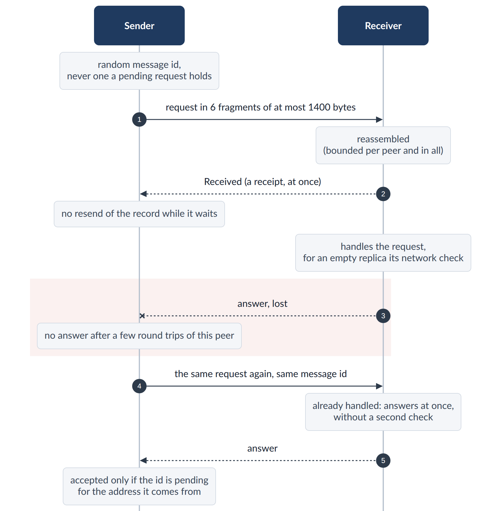

*Source: [`docs/design/transport.mmd`](docs/design/transport.mmd).*

Without resends a single lost datagram cost the whole 2.5 s timeout. Measured
with 0.5% loss, 30 nodes and k=5, under the earlier rule that refused a STORE
when a node did not answer, 26 of 80 publications lost a replica without
resends and none of 80 with them.

Nodes of earlier releases cannot decode the records or the messages of this
one, so all nodes of a network must run the same release.

## 5. Routing

The routing table is Kademlia's: k-buckets over the 256-bit space, split when
they cover the node's own id or when the depth is not a multiple of 5. A
lookup asks `alpha` nodes at a time and moves towards the key until the `k`
closest nodes it knows have all answered. Defaults: `k = 20`, `alpha = 3`.

A node that sends a message enters the routing table at once (Kademlia §2.2),
however busy the node is sending records to other new nodes (section 11). When
its bucket is full and cannot split, the bucket's oldest contact is pinged to
learn whether it is still there, and the newcomer waits in the replacement
list. That ping runs once at a time per contact, so a flood of made-up
identities does not turn every message into a ping. Until November 2026 a node
met while another was being sent its records was dropped instead. A lookup
would usually find it again in a large network, but not in a small one: after
one bootstrap pass of 30 nodes with `k = 20`, half of the nodes knew at most
20-22 of the 29 others, against 26-27 now.

Unresponsive contacts follow Kademlia §4.1 rather than being dropped at the
first timeout. A failure starts an exponential backoff (5 s to 300 s), and
after 5 failures in a row the contact is stale: it is replaced if a replacement
exists, otherwise kept but not advertised. Any answer clears the failures. A
lookup does not re-ask a peer that failed during it, nor a peer this node knows
is failing, even when other nodes keep reporting it. A once-per-second
maintenance tick pings failing contacts whose backoff has elapsed and, when the
node has no live contact, retries its bootstrap seeds.

## 6. Publication (SET)

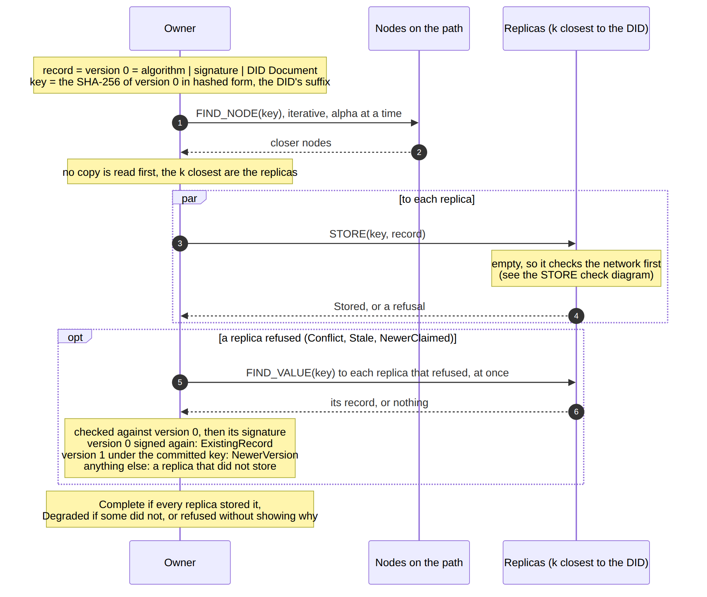

*Source: [`docs/design/publish.mmd`](docs/design/publish.mmd).*

SET publishes a record of any position: the first publication of a DID and
every rotation are the same operation. The owner finds the `k` closest nodes
with a node lookup and sends them the record as STORE, the owner included if
it is one of them. It reads no copy first: the replicas decide by what they
hold and check the network themselves (section 7). A replica that refuses
counts only once it shows why: the owner asks it for its record, checks that
a replica holding it would refuse, and verifies it. The outcome is reported
per replica:

- **Complete:** every replica stored the record. Replicas are the nodes that
  answered the lookup; a node that did not is not counted as one.
- **Degraded:** at least one replica stored it, but some did not answer the
  STORE, had no room, or refused it without showing why
  (`unproven_refusals`).
- **Rejected:** a replica showed another valid record at the same position
  (`existing_record`) or a valid higher position (`newer_version`), the
  record is invalid, or no replica stored it.

No number of refusals that are not shown rejects a publication: one node
answering under many made-up ids could reach any number [Douceur 2002].

A retry of the same record is safe: replicas that already hold it answer
`AlreadyStored`, and the retry completes the ones that missed it.

## 7. Storing at a replica (STORE)

A replica first checks the form of the record and its key against the tree
(section 3, step 1). Then, if it already holds a record for the key, it
decides on its own, with what it holds:

- **The same bytes:** `AlreadyStored`, nothing verified; the expiry is
  refreshed.
- **A higher position:** once its signature verifies, it replaces the stored
  record, by a compare and swap that fails if the record changed meanwhile.
  The positions in between are not needed.
- **A lower position:** `Stale`.
- **Another record at the same position:** once its signature verifies,
  `Conflict`, and the stored record stays. It is logged as a repeated
  signing when the document is the same, as duplicity when it differs: only
  the owner, or a thief of that position's key, could have signed it.

A replica whose record expired remembers its position for one more TTL (the
marker, section 11). A lower position is then `Stale` without asking
anyone; that position or a higher one goes through the network check below,
as at a replica that holds nothing.

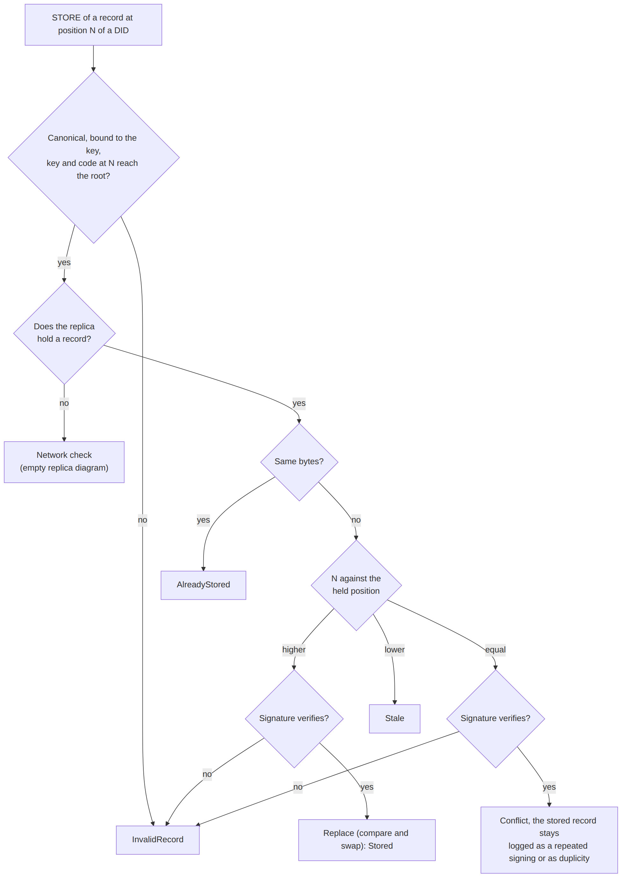

*Source: [`docs/design/replica-rules.mmd`](docs/design/replica-rules.mmd).*

A replica that holds nothing knows the record is the owner's, since it
proves its own key, but not whether the owner has published a higher
position since: a replayed record would otherwise bring back an old key. So
an empty replica asks the network before storing:

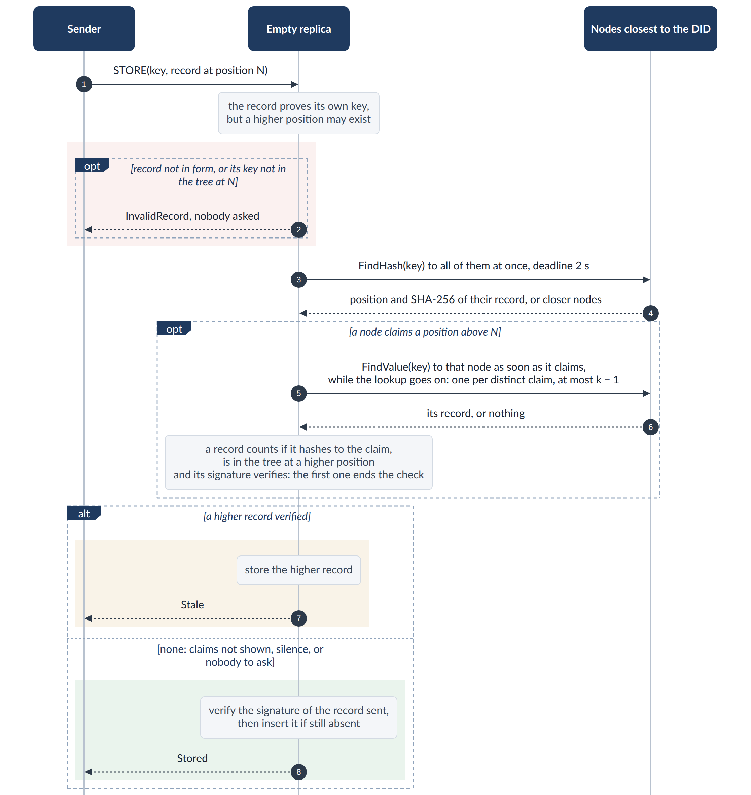

*Source: [`docs/design/store-check.mmd`](docs/design/store-check.mmd).*

1. It checks the form and tree of section 3, without the signature. A record
   that does not belong to the key is `InvalidRecord`, and nobody is asked: a
   malformed or forged STORE does not cost a lookup.
2. It sends `FindHash` to the nodes closest to the key, asking for the
   position and SHA-256 of the record they hold, all of them rather than
   stopping at the first answer, and leaves no cached copy behind. A replica
   asks them all at once, not three at a time as a GET does: a node asked
   late could be pushed out of the lookup by made-up nodes closer to the key
   in an earlier answer. A node that knows `k` nodes closer to the key than
   itself is not a replica and keeps three at a time. The check ends after
   2 s, fetches included.
3. For each distinct claim of a higher position, it asks the closest node
   that made it for its record (`FindValue`), at most `k − 1` of them, all at
   once. A record counts only if it hashes to the claim, has the form of
   section 3 for the key at a higher position, and its signature verifies.
4. **A higher record verified:** the replica stores it instead and answers
   `Stale`. One is enough, however many nodes claim lower positions.
5. **Otherwise:** it verifies the signature of the record it was sent and
   stores it, whether every node answered, some did not, or it knew nobody
   to ask.

**Why silence does not refuse.** Saltzer and Schroeder's fail-safe default is
to "base access decisions on permission rather than exclusion"
[Saltzer 1975]. Here the permission is the record itself: it proves, from
the DID alone, that the owner signed it. The check looks only for a fact that
withdraws it, a higher record, and a claim that cannot be shown or a node
that stays silent is no such fact. Under the earlier rules, where a record
could not prove its own key, the answers of other nodes were the only
evidence of authenticity, so silence had to refuse; one silent node then
kept an empty replica empty.

**Why hashes, not records.** A node holding the record answers with its
SHA-256, 32 bytes in one datagram, instead of a whole record, about 7 KB in
five or six fragments. With records, every check cost about `k` records, and
a burst of STOREs made the replica receive more fragmented answers from the
same holder than its reassembly limit allows, so it dropped them. The
replica fetches whole records only for claims above the position it was
sent, so a check without such claims fetches nothing, and made-up claims
cost at most `k − 1` fetches. SHA-256 resists second preimages, so a node
cannot serve another record under the hash of a genuine one.

**What it costs.** One lookup per STORE at an empty replica, small answers
only, and a fetch only when a node claims a higher position. A STORE to an
empty replica takes a few round trips longer.

**What it does not do.** It is a read before write without consensus. It
hears every node the replica knows, not every node that exists: a node that
answers with made-up nodes closer to the key can still push out of the
lookup a holder the replica learns of only from another answer, before it is
asked. When no holder of a higher position answers in time, the replica
stores an authentic but superseded record (section 13).

The check runs outside the workers that read incoming datagrams (section 12),
because the answers to its own lookup arrive through those workers. Run on a
worker, 8 such STOREs at once left their lookups without answers.

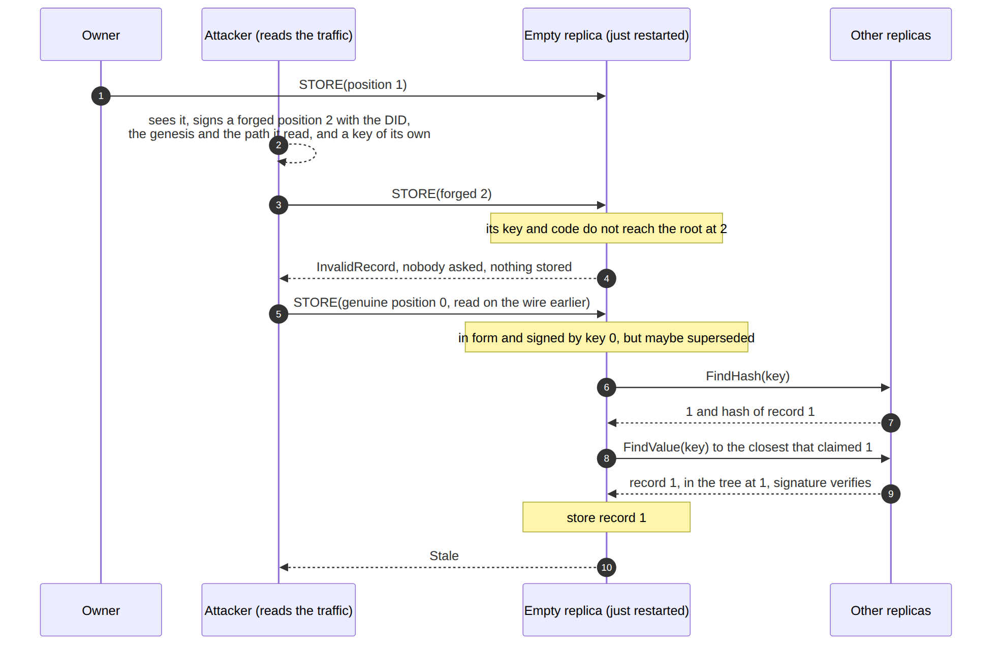

*Source: [`docs/design/attack.mmd`](docs/design/attack.mmd).*

## 8. Reading (GET)

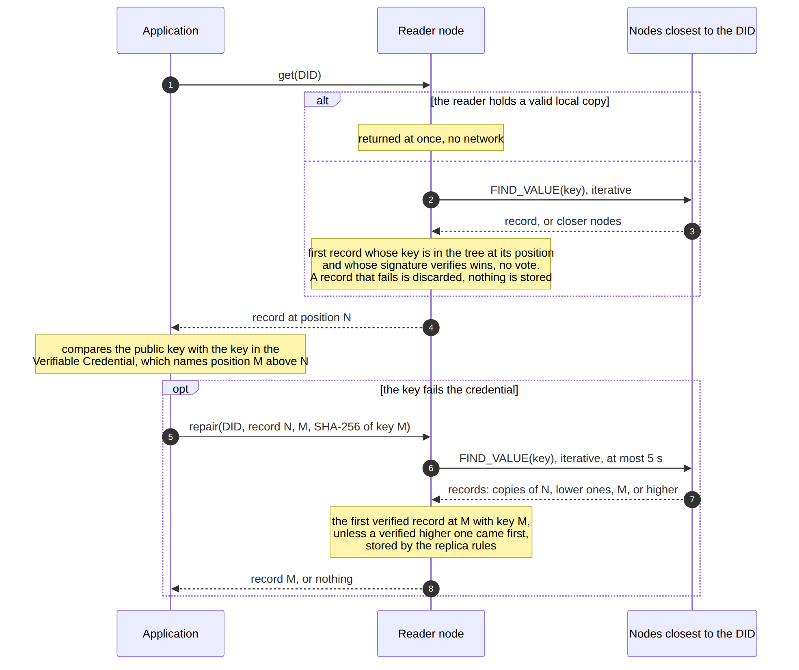

*Source: [`docs/design/get.mmd`](docs/design/get.mmd).*

A node that holds a valid copy returns it at once, without asking the
network. Otherwise it runs the Kademlia value lookup and, as in Kademlia
§2.3, stops at the first record that passes the checks of section 3. A record
that fails is discarded and the lookup goes on, so one bad replica cannot end
a read. A GET stores nothing it finds.

There is no vote among replicas. A record proves on its own that the owner
signed it, and a vote would not tell which position is current: replicas
behind would outvote the one that holds the latest. A GET therefore proves
that the record is the owner's, not that it is the current position. **The
application must compare the public key with the key in the Verifiable
Credential**, and that protects against a superseded record only if the
credential of a superseded key is revoked, or expires, at rotation.

**Repair.** When the key a node serves fails the credential, the application
knows from that credential which position and key it expects, and asks for
them (`repair`). The node runs one value lookup, bounded at 5 s, that goes
past copies of the record that failed, lower positions and records that do
not verify, and takes the first verified record at the expected position
with the expected key. A verified higher record met first supersedes it, and
the repair finds nothing. The record found is written as a replica writes a
STORE: it replaces a lower position, never a higher one nor another record
at its own, so a writer that stored a higher record meanwhile wins. The next
GET serves it locally. A repaired record is an ordinary stored record, on a
node among the `k` closest to the DID or not. Only the repair writes what a
lookup found, because the application has checked it against a credential;
a GET that wrote would store whatever a node served.

## 9. Key rotation

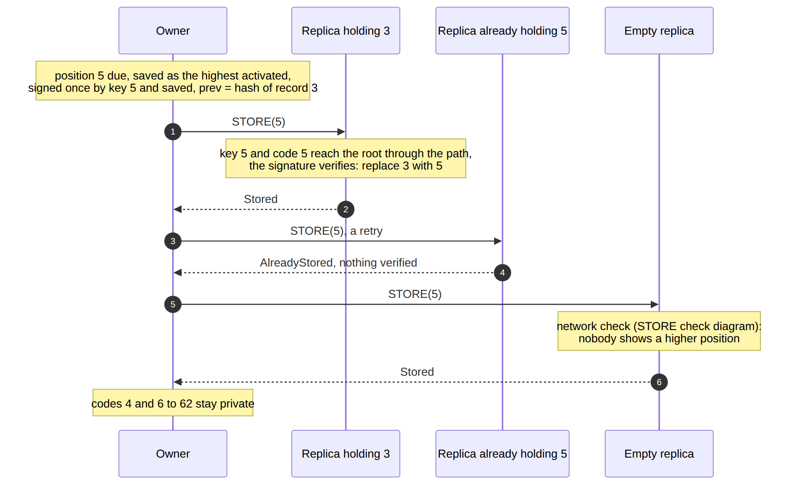

*Source: [`docs/design/rotation.mmd`](docs/design/rotation.mmd).*

A rotation replaces the ML-DSA-65 key, the only key of the document, and
needs new VCs. Key agreement between devices happens outside the DHT, with
ephemeral keys (ADR 0003), so no KEM key is published or rotated. A rotation
is the publication of a higher position with SET: its key is the one the
tree commits to at that position, so a replica holding any lower position
checks it on its own, with the path in the record and one signature, and
replaces what it holds. Nothing else is sent: a replica behind by several
positions, or one that holds nothing, takes the new record directly.

1. The owner picks the position due by its schedule, above every position
   activated so far, and saves it as the highest activated before signing,
   so that a restart never reopens a lower one. This order is the one
   SP 800-208 requires for the index of a stateful hash-based key
   [SP 800-208, §8.1, §9.1]; here a reopened position does not break
   ML-DSA-65, but creates two records at one position.
2. It builds the document of that position, with `prev` naming the record
   published before, signs it once with that position's key, and saves it.
3. It publishes it with SET (section 6). The positions skipped, for example
   after an outage, are never released: their codes stay private.
4. A replica already holding the record answers `AlreadyStored` without
   verifying: retrying a publication is safe, as for an idempotent request
   [RFC 9110 §9.2.2] [Hohpe 2003]. The retry must resend the same bytes: a
   second signature of the same position is refused as a conflict.

A thief of the current key cannot rotate: a higher position needs its own
key and its code, neither of them released. It can sign another document at
the current position, whose code is public; the owner answers by publishing
the next position at once, before its slot, which replaces both wherever it
arrives, and by having the stolen key's credential revoked. The decision to
rotate early and its authorization belong to the application, not to the
DHT.

An old record cannot be replayed as current at a replica that holds a higher
one (`Stale`), nor at an empty replica while a holder of a higher one
answers its check. No node reads a clock to decide a position.

**Custody.** The owner's side of these steps is the `Custody` trait
(`src/custody/`), so that a backend inside a trusted execution environment
can replace the first one, in files, and produce the same records. The
application writes one template of its document; the custody fills in
`seq`, `prev` and the position's key, adds the DID and the proof, and signs,
so a code never passes through the application before its record. It signs
a position only when its slot has come: from a start `T`, every interval
`D`, the position due is `floor((now - T) / D)`, or the highest activated if
greater. It writes a new position as the highest activated, flushed to the
device, before returning its record; within the slot it returns the same
bytes again, and it never signs below the highest activated. Before its slot
only the next position that is not skipped can be activated, once, with an
authorization the application's verifier accepts (the issuer's, in this
project); the position due then becomes that one, so the next falls due at
its normal boundary. A position whose key has leaked is skipped for good.
Once a record is published, the secrets of the positions below it are
erased. The file backend keeps the seeds and codes, the calendar and the
records in a directory only the process's user can read: it trusts the
device's clock and files, and enforcing the calendar against the host needs
a backend that keeps its own.

## 10. Status List

The Status List lists revoked credentials and is signed by the issuer with
ML-DSA-65, whose raw public key (1952 bytes) every node reads from
`issuer.bin`. Because it changes more often
than DID Documents, reads use a quorum: with `alpha = 3`, two byte-identical
copies out of at most three, the local copy counting as one. A split with no
majority returns nothing. The issuer publishes the first list with SET and
replaces it with `UpdateStatusList`, which succeeds on a strict majority of
at most `alpha` replicas. It is exempt from the STORE check of section 7,
which is about DID records. The list carries no version yet, so nodes accept
any list the issuer signed, an older one included.

## 11. Replication, churn and expiry

- **New nodes** receive the records they become responsible for (Kademlia
  §2.5): when a node learns of a new contact, it sends that contact the records
  for which the contact is now among the closest and this node is the closest.
  These STOREs go through the rules of section 7. Finding those records means
  scanning the whole storage, so new nodes wait for their records in a queue,
  one at a time (section 12). A node beyond the queue's bound is still added
  to the routing table and gets its records from the next republication.
- **Returning nodes**, silent for at least 2.5 s, are treated as new and
  refilled the same way. A node that crashes and restarts within about a second
  is not noticed by its neighbours, and stays empty until a republication.
- **Republication:** every hour each node sends records older than an hour to
  the `k` closest nodes. An empty replica stores what it is sent unless a node
  shows it a higher position, and a replica behind takes any higher position,
  so the holders alone refill the replicas that came back empty and move on
  those left behind. A replica that refuses a republication as `Stale` may
  hold a higher position the holder lacks: the holder asks one of these
  replicas, drawn at random, for its record, and takes it if a replica
  holding its own would, a verified higher position. One fetch per record and
  republication bounds what made-up refusals cost, and the random draw keeps
  one node that always refuses without showing anything from blocking every
  repair.
- **The owner's republication:** at least every 24 hours, and whenever it comes
  back online, the owner sends its current record again with the saved bytes.
  It restores the copies when no holder is left, and replaces a superseded
  record an empty replica took (section 13).

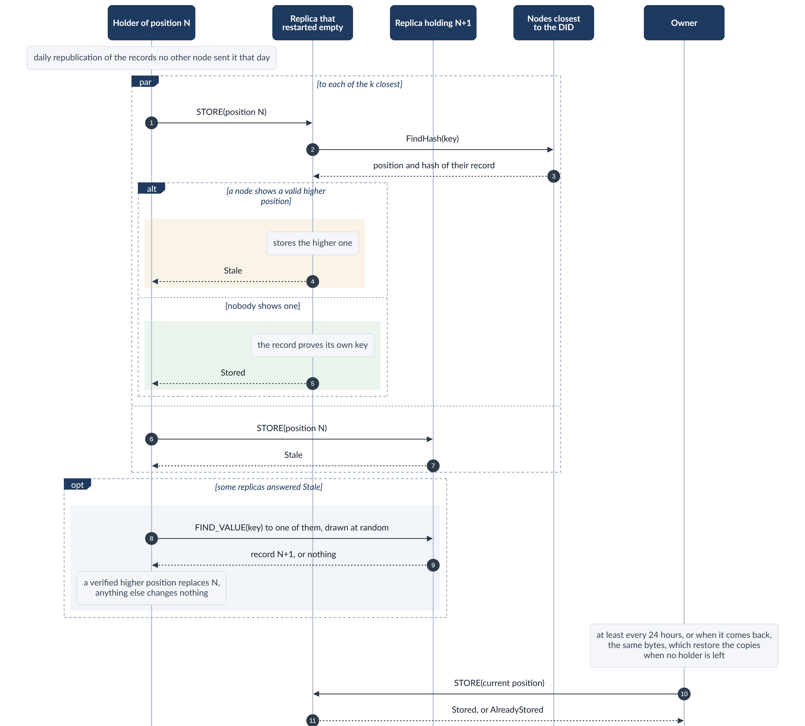

*Source: [`docs/design/repair.mmd`](docs/design/repair.mmd).*

- **Expiry:** records expire 14 days after they were written or last
  renewed. There is no delete. An application that needs a record to stay
  must publish it again before then. Once a DID record expires, the replica
  keeps only its key and position, the marker, for 14 more days from that
  expiry: a replay of a lower position meanwhile is stale even if no node
  answers its check. Only a stored, verified record sets a marker, and
  nothing extends it.
- **Restarts:** a replica given a data directory keeps each record in a file
  and serves it again after a power cut, with the rest of its TTL, before any
  other node answers. A new or changed record is on the device before the
  replica acknowledges it; if the disk refuses the write, nothing changes
  and the replica does not answer, so the sender counts it as unavailable.
  A renewal of the same bytes only moves the expiry, so it reaches the disk
  with the next hourly flush: a power cut loses at most an hour of TTL, which
  the next renewal gives back. A file is replaced by writing a temporary one,
  flushing it, renaming it over the old one and flushing the directory, so a
  power cut leaves the old file or the new one. The marker of an expired
  record lives in the same file. Without a data directory a replica restarts
  empty, as before.

## 12. Concurrency and resource bounds

- One task reads the socket and hands datagrams round-robin to one worker per
  core. When every worker's queue is full, reading waits instead of dropping.
- Signature verification runs on a blocking pool capped at the number of cores,
  so that a small ARM board is not swamped by threads. The caller builds the
  Tokio runtime with that cap.
- A STORE that needs the check of section 7 runs in its own task, at most 256
  at once. Beyond that the STORE is dropped, as an overloaded node drops
  datagrams. Each check fetches at most `k − 1` records.
- Storage holds at most 512 MiB by default and never evicts a live record to
  make room: a full node answers `CapacityExceeded`. A marker costs its key
  and 16 bytes.
- With a data directory, a write of a new or changed record waits for the
  device under the lock of its entry, so that memory and disk never
  disagree. Such writes are rare, a first copy or a rotation; renewals,
  expiries and the hourly flush run on the blocking pool.
- Sending new nodes their records (section 11) scans the whole storage, so one
  scan runs at a time and at most 256 nodes wait for it. The bound is on the
  records, not on the routing table: a node met beyond it is still added. The
  scan reads the routing table 256 records at a time, so a node making contact
  meanwhile does not wait for the whole scan to enter the table.
- The routing table sits behind Tokio's `RwLock`, which is fair: a waiting
  writer goes before readers that come after it. A value lookup (a DID read,
  and the check of section 7) therefore runs each request to a peer as its own
  task. Between two answers the lookup reads or writes the table, and a request
  may be waiting to write it, because a node met in an answer enters the table.
  If the lookup polled its requests itself, it would stop polling them while it
  waits for the table. The lock would then be handed to a request nobody polls,
  and the whole node would stop. This is the "futurelock" of [Oxide RFD 609],
  which recommends a `JoinSet` for such sets of requests. It happened in the
  testbed with 127 nodes, `k = 20`: a node stopped answering two seconds after
  the first publication. Lookups that wait for every answer of a round before
  touching the table (`join_all`) are not affected.

## 13. Known limits

- **An empty replica can store a superseded record.** When no holder of a
  higher position answers its check in time, because there is none among the
  nodes it knows, because made-up nodes pushed it out of the lookup, or
  because of a partition, it stores the authentic but older record it is
  sent. It serves it until a higher one reaches it, from a holder's
  republication or the owner's, which it then takes. Meanwhile readers rely
  on the credential check of section 8, and repair their copy.
- **Made-up ids cannot forge, but they cost.** A node answering under many
  ids can delay a check up to its deadline, make the replica fetch up to
  `k − 1` records, hide a higher record from an empty replica, and fill
  routing tables. It cannot make a replica store a record the owner did not
  sign.
- **An answer counts for the address it comes from.** Message ids are drawn
  at random for each request, so a node that does not read the traffic cannot
  answer for another; one that reads it can, and then hide a higher record
  from an empty replica as above.
- **A stolen key of a published position** can sign another document at
  that position, which holders refuse and an empty replica that sees no
  higher position may store. The owner's next position supersedes it.
- **A copy of all the seeds and codes** gives every future position to its
  holder: the DID must be replaced. A lost store ends rotation the same way.
- **The file custody trusts its host.** A party that can write its files or
  set the clock can move the calendar, and a custody restored from an older
  backup can sign a published position again.
- **A tree has 63 positions.** Once position 62 is published the DID cannot
  rotate again; moving to a new tree is not defined yet.
- **Expiries follow the device's clock.** They are wall clock times, so that
  a record keeps its TTL across a restart: a clock set forward expires
  records early, one set back keeps them longer.
- **The data directory is trusted.** Records read from it are verified again
  before a GET returns them, but a party that can write it can plant a
  marker that makes the replica refuse a DID's lower positions for its
  lifetime.

## 14. How behaviour is measured

`testbed/` runs one node per Docker container, with latency and loss emulated
by `tc netem` from published backbone measurements (LAN, WAN Europe, WAN
Trans-Atlantic), and an attacker that reads all the containers' traffic. It
sends forged records (the owner's DID and the public proof of the position
it saw, its own key): one per rotation (`race`), many at once (`burst`), a
position 1 right after each position 0 (`successor`), or to every node all
the time (`persist`); and it can answer `FindHash` for other nodes under
guessed ids (`spoof`). A testbed-only switch makes chosen nodes lie in
`FindHash`. Measurement modes time publications, rotations with replicas
restarted empty, and count copies over time under churn. See
`testbed/README.md` for the commands, and `EXPERIMENTS.md` for the
experiments and their results.

## 15. References

- [Birrell 1984] A. D. Birrell and B. J. Nelson, "Implementing Remote Procedure
  Calls", *ACM Transactions on Computer Systems* 2(1), 1984.
- [Douceur 2002] J. R. Douceur, "The Sybil Attack", IPTPS 2002.
  https://doi.org/10.1007/3-540-45748-8_24
- [FIPS 204] NIST, "Module-Lattice-Based Digital Signature Standard", FIPS
  204, August 2024.
- [Hohpe 2003] G. Hohpe and B. Woolf, *Enterprise Integration Patterns*,
  Addison-Wesley, 2003, "Idempotent Receiver".
- [Karn 1987] P. Karn and C. Partridge, "Improving Round-Trip Time Estimates in
  Reliable Transport Protocols", ACM SIGCOMM 1987.
- [KERI] Trust over IP, "Key Event Receipt Infrastructure (KERI)", v1.1,
  "Pre-rotation" and "Reserve Rotation".
  https://trustoverip.github.io/kswg-keri-specification/
- [Maymounkov 2002] P. Maymounkov and D. Mazières, "Kademlia: A Peer-to-peer
  Information System Based on the XOR Metric", IPTPS 2002.
- [Oxide RFD 609] Oxide Computer Company, "Futurelock", RFD 609, 2025.
  https://rfd.shared.oxide.computer/rfd/0609
- [RFC 6298] V. Paxson, M. Allman, J. Chu and M. Sargent, "Computing TCP's
  Retransmission Timer", RFC 6298, 2011.
- [RFC 8391] A. Huelsing, D. Butin, S. Gazdag, J. Rijneveld and A. Mohaisen,
  "XMSS: eXtended Merkle Signature Scheme", RFC 8391, 2018, §4.1.8.
- [RFC 8554] D. McGrew, M. Curcio and S. Fluhrer, "Leighton-Micali Hash-Based
  Signatures", RFC 8554, 2019, §5.4.
- [RFC 9110] R. Fielding, M. Nottingham and J. Reschke, "HTTP Semantics",
  RFC 9110, 2022, §9.2.2 "Idempotent Methods".
- [RFC 9162] B. Laurie, E. Messeri and R. Stradling, "Certificate
  Transparency Version 2.0", RFC 9162, 2021, §2.1.1.
- [RFC 9964] "ML-DSA for JOSE and COSE", RFC 9964, May 2026.
- [Saltzer 1975] J. H. Saltzer and M. D. Schroeder, "The Protection of
  Information in Computer Systems", *Proceedings of the IEEE* 63(9), 1975,
  section I-A-3.
- [SP 800-208] D. A. Cooper et al., "Recommendation for Stateful Hash-Based
  Signature Schemes", NIST SP 800-208, 2020.
  https://doi.org/10.6028/NIST.SP.800-208
- [Trungadi 2025] F. Trungadi et al., "Securing Modbus in legacy industrial
  control systems: A decentralized approach using Proxies, Post-Quantum
  Cryptography and Self-Sovereign Identity", *Journal of Information Security
  and Applications* 94 (2025) 104199. https://doi.org/10.1016/j.jisa.2025.104199
