# AuthKademlia-RS design

This document explains how AuthKademlia-RS works and why: what a node stores,
how records are published, read and rotated, and what each choice defends
against. It describes the protocol, not the API: see `README.md` for usage and
`AGENTS.md` for the code map. The diagrams are PNG images drawn from the
Mermaid sources in `docs/design/` (`*.mmd`), so that they show where Mermaid is
not drawn, as in the GitHub mobile app.

## Contents

1. [Purpose and architecture](#1-purpose-and-architecture)
2. [Threat model and security properties](#2-threat-model-and-security-properties)
3. [Identifiers, records and the chain of versions](#3-identifiers-records-and-the-chain-of-versions)
4. [Transport](#4-transport)
5. [Routing](#5-routing)
6. [Publication (SET)](#6-publication-set)
7. [Storing at a replica (STORE)](#7-storing-at-a-replica-store)
8. [Reading (GET)](#8-reading-get)
9. [Key rotation (UPDATE)](#9-key-rotation-update)
10. [Status List](#10-status-list)
11. [Replication, churn and expiry](#11-replication-churn-and-expiry)
12. [Concurrency and resource bounds](#12-concurrency-and-resource-bounds)
13. [Known limits](#13-known-limits)
14. [How behaviour is measured](#14-how-behaviour-is-measured)
15. [References](#15-references)

## 1. Purpose and architecture

AuthKademlia is the Verifiable Data Registry (VDR) of the `did:iiot` method
[Trungadi 2025]. It stores two kinds of records: DID Documents, which hold a
device's post-quantum public key (ML-DSA-65 [FIPS 204]), and the Status List
of revoked credentials, signed by an issuer.

The DHT is Kademlia [Maymounkov 2002] with one change that shapes everything
else: **a node stores a value only if it is an authenticated record**, a DID
Document signed by the key it contains, or the Status List signed by the
issuer.

### Architecture

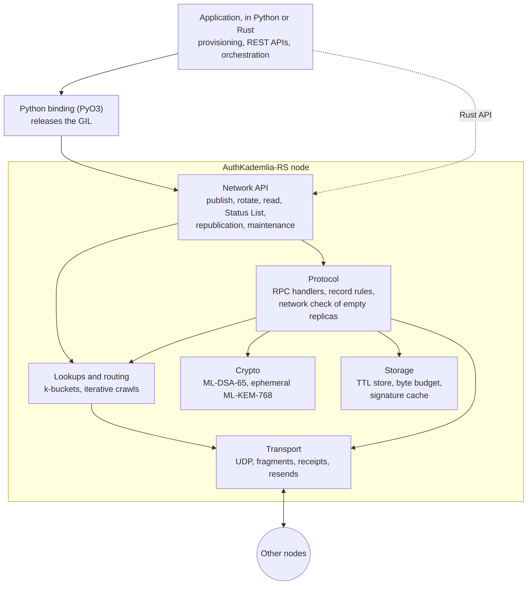

*Source: [`docs/design/architecture.mmd`](docs/design/architecture.mmd).*

A node is one Rust process; the application above it, in Python through the
PyO3 binding or in Rust, decides what to publish and when.

| Component | Role | Section |
|---|---|---|
| Network API | Publication of version 0, rotation, reads, the Status List; hourly refresh and republication, maintenance of contacts | 6, 8, 9, 10, 11 |
| Protocol | The RPC handlers; the rules a replica applies to a record; the network check of an empty replica | 7, 9 |
| Lookups and routing | Kademlia's k-buckets and iterative lookups | 5 |
| Transport | UDP datagrams, fragments of large records, receipts and resends | 4 |
| Crypto | ML-DSA-65 signatures of records; ephemeral ML-KEM-768 key pairs for the application | 3 |
| Storage | Records with a 14-day TTL and a byte budget; a cache of signature verifications | 3, 12 |

The Python binding releases the GIL before entering Rust, so signature
verifications, which are CPU-bound, run on every core while the application
stays in Python.

## 2. Threat model and security properties

The DHT must hold up against:

- **A network attacker** who reads all traffic and sends packets of its own,
  from as many ports as it likes, next to any node. In the testbed this
  attacker cannot modify or drop the owner's packets. If it could, it would
  still not forge a signature, but it could deny service.
- **Malicious nodes** that answer requests with anything, or not at all.
- **Forged records**: anyone can generate a key pair and sign a document that
  claims a DID. The first version of a DID cannot be forged, since the DID is
  its hash (section 3), but a later version can be: a self-signed version N
  with the right `prev` and a key of the attacker's own is consistent, and
  only the version before it shows that its key was not the committed one.

Out of scope for the DHT, by design:

- **Who owns a DID.** The binding between a DID and its key is the
  Verifiable Credential: the application compares the public key in the DID
  Document with the hash in the VC. A reader that skips that check can be given
  a forged document (section 8).
- **An attacker who controls every node close to a DID.** It decides what that
  DID resolves to. Kademlia's defences against such eclipse attacks (many
  disjoint lookups, costly node ids) are not implemented.

The DID is derived from the first document, not from the current key (ADR
0005): it stays the same across rotations, as a random identifier did, and
nobody can write a first document for another device's DID, as nobody could
with a key-derived one. Each version names the hash of the next key, so the
chain of versions carries the authority to rotate, as in KERI's pre-rotation
[KERI].

### Security properties

Each property, the mechanism that provides it, and what it rests on:

| Property | Mechanism | Holds while | Section |
|---|---|---|---|
| **Authenticity** of a record: its document was signed by the key it declares | ML-DSA-65 signature, verified by every node before storing or returning a record | ML-DSA-65 is unbroken | 3 |
| **Binding** of a DID: nobody can store a first document under another device's DID | The DID is the SHA-256 of the first document in hashed form | SHA-256 resists collisions and second preimages | 3 |
| **Control** of a DID: only its owner can publish the next version | Each version commits to the hash of the only key that may sign the next one; the next key is kept as a seed until it is used | The next seed is better guarded than the current key | 3, 9 |
| **Order** of versions: an old version is not taken for the current one | `seq` and `prev` at a replica that holds the DID; the network check at an empty one | At an empty replica, fewer than a quorum of the nodes it asks collude | 7, 9 |
| **No forged record** at an empty replica | The network check, which refuses on any doubt and on silence | Fewer than a quorum of colluders among the nodes asked, and one honest holder refuses | 7 |
| **Answers** come from the nodes asked | Message ids drawn at random, matched with the source address | The attacker cannot read the traffic | 4 |
| **Availability** of a record | `k` replicas; republication by the holders and by the owner | A quorum of holders, or the owner, is online, and no neighbour lies | 11, 13 |
| **Bounded resources** under load | Storage budget, bounded reassembly, bounded queues and lookups | | 4, 12 |
| **Post-quantum** security | ML-DSA-65 for records; key agreement by ephemeral ML-KEM-768, outside the DHT | | 3 |

Not provided: that a record read is the current one, or that it belongs to
the device. The application compares the public key with the hash in the
Verifiable Credential (section 8).

## 3. Identifiers, records and the chain of versions

| Item | Definition |
|---|---|
| Node id | 256 bits. Distance is the XOR of the full 256 bits, never folded |
| DID | `did:iiot:` and the base64url, without padding (43 characters), of the SHA-256 of version 0 in hashed form (below) |
| DHT key of a DID | The DID's suffix, decoded: the 32 bytes of that hash |
| DHT key of the Status List | `SHA-256("status-list")` |
| Record | `algorithm (12 B) | signature | DID Document (canonical JSON)` |

The algorithm field must be `ML-DSA-65` (ADR 0003): a record with any other
is refused, so no DID is published with a key a quantum computer breaks. The
signature is pure ML-DSA with an empty context, 3309 bytes. The document has
one key, a JWK of the type RFC 9964 defines [RFC 9964]: `{"kty": "AKP",
"alg": "ML-DSA-65", "pub": <base64url>}`.

Every document carries three fields that make a chain of versions (ADR 0005):
`seq`, its number, from 0; `prev`, the base64url SHA-256 of the whole record
before it (not in version 0); and `nextKeyHash`, the base64url SHA-256 of the
raw public key that alone may sign the next version. A version that commits
to its own key is refused. Documents are in a canonical form, so that one
document has one hash: printable ASCII only, integers within ±(2^53 − 1)
without fraction or exponent, sorted keys and no whitespace, and the bytes
must equal their re-serialization.

The **hashed form** of version 0 is the document without `id`, with its own
DID written as the placeholder `did:iiot:self` wherever a string value is the
DID or a DID URL of it (`#`, `?` or `/` after it). The owner builds that draft,
hashes it, and writes the DID back in, `id` included. A document that already
holds the placeholder is refused, so the hashed form cannot be ambiguous.

A record is accepted for a key only if:

1. **Form and binding:** the document is canonical; its `id` is a DID whose
   suffix is canonical (it encodes back to itself, so one DID is one key) and
   decodes to the key; `seq`, `prev` and `nextKeyHash` are well formed. For a
   version 0, the SHA-256 of its hashed form is the key: nobody can store a
   first document under another device's DID. A later version binds by its
   `id`; its place in the chain is checked by the rules of section 7.
2. **Signature:** the document's key has `kty` `AKP` and the `alg` of the
   record's algorithm field, and the signature verifies over the canonical
   JSON with that key, the one the document itself declares.

A verification result can be cached under the SHA-256 of the record (one hour,
4096 entries). A cache miss is a full verification, never a bypass.

### Creating a DID

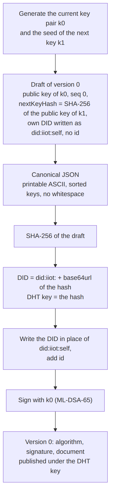

*Source: [`docs/design/did-creation.mmd`](docs/design/did-creation.mmd).*

A device creates its DID once, before publishing anything: it generates its
current key pair and the seed of its next key, writes the draft of version 0
with `did:iiot:self` in place of its own DID, and hashes it. The hash is both
the DID and the DHT key. It then writes the DID into the document, signs it,
and publishes it with SET (section 6).

### The chain of versions

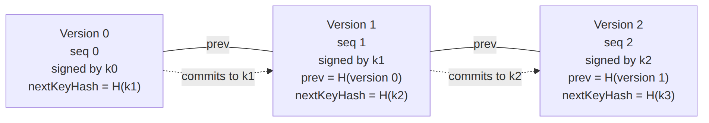

*Source: [`docs/design/version-chain.mmd`](docs/design/version-chain.mmd).*

Every later version names the record before it (`prev`) and is signed by the
key whose hash the version before committed to (`nextKeyHash`), so each update
rotates the key. A replica that holds version N−1 checks version N on its own:
one SHA-256 of the stored record, one of the new key, one signature
verification. The device keeps every version it published, from version 0, to
replay the chain to replicas that miss versions (section 9).

## 4. Transport

Nodes talk over UDP. A message is a `bincode` envelope
`(message id, is request, message)`. Requests and answers are matched by
message id and by the peer's address, and an answer of the wrong type is
discarded. Each request draws its message id at random, never one a pending
request holds, so a node that does not read the traffic cannot answer in
another node's place: an answer counts only if its id is pending for the
address it comes from.

Post-quantum records are about 6.5 KB, more than one datagram, so every message
is split into fragments of at most 1400 bytes with a 12-byte header (`KADF`,
fragment id, index, total). Reassembly is bounded: at most 256 KB per message,
64 partial messages in all, 8 per peer, kept 10 s. These limits protect memory.
They also mean that a node receiving many large answers from the same peer at
once drops some: section 7 explains why the STORE check avoids large answers.

| Request | Answer | Purpose |
|---|---|---|
| `Ping` | `Pong` | Liveness and discovery |
| `FindNode` | `FindNodeResult` | The closest nodes to a key |
| `FindValue` | `FindValueHit` or `FindValueNodes` | A record, or closer nodes |
| `FindHash` | `FindHashHit` or `FindValueNodes` | The `seq` and SHA-256 of the record a node holds (section 7) |
| `Store` | `Received`, then `StoreResult` | Store a version: after the network check if the node holds none, or as the verified successor of the one it holds (section 7) |
| `Update` | `Received`, then `UpdateResult` | The next version of a DID, the record only (section 9) |
| `UpdateStatusList` | `Received`, then `UpdateStatusListResult` | New Status List from the issuer |
| `Leave` | none | Graceful departure |

A request waits at most 2.5 s for its answer. UDP loses datagrams, so a
request with no sign of its peer after a few round trips is sent again, the
same datagrams with the same message id, at most twice, waiting twice as long
each time. The wait is three round trips of that peer, or the smoothed round
trip plus four times its variation if that is longer (RFC 6298), between 20 ms
and 1 s, and 500 ms for a peer never measured. A round trip is measured only
on a request sent once, since the answer to a resent one could belong to
either copy (Karn's algorithm).

A request that carries a record is answered only once the record is handled,
which at an empty replica includes the network check of section 7, two or
three round trips. Such a request gets a receipt, `Received`, as soon as it
arrives. The sender then does not resend the record while it waits, and a
later copy only asks for an answer that may have been lost: a replica that has
stored the record answers it at once with "already stored". A copy that
arrives while the request is still being handled is recognised (same sender,
same bytes) and gets the receipt again, without a second check. This is the
classic scheme of remote procedure calls over datagrams (Birrell and Nelson,
1984): retransmission, acknowledgement of long calls, suppression of
duplicates.

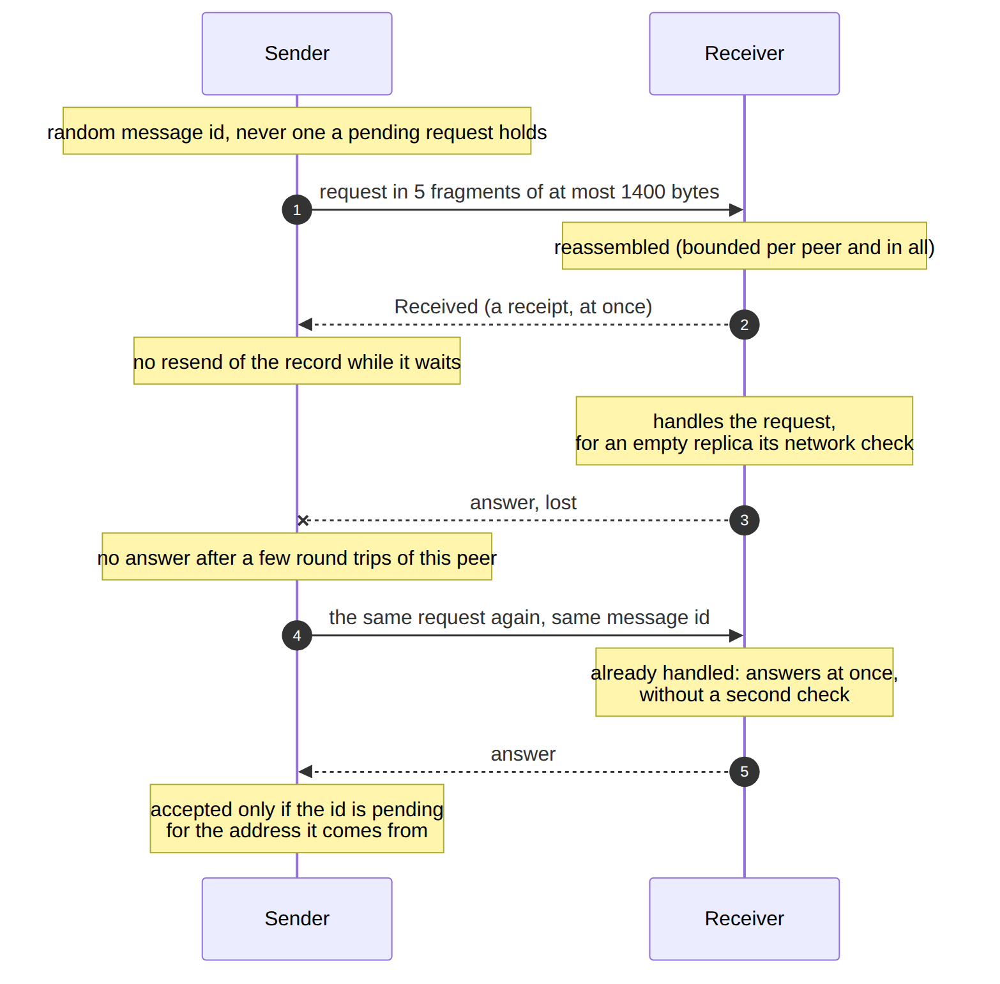

*Source: [`docs/design/transport.mmd`](docs/design/transport.mmd).*

Without resends a single lost datagram cost the whole 2.5 s timeout, and in
the STORE check it also made the replica refuse (section 7). Measured with
0.5% loss, 30 nodes and k=5, 26 of 80 publications lost a replica with the
check alone and none of 80 with resends (section 14).

`FindHash` and `Received` are the newest messages: nodes that do not know them
cannot decode them, so all nodes of a network must run a version that does.

## 5. Routing

The routing table is Kademlia's: k-buckets over the 256-bit space, split when
they cover the node's own id or when the depth is not a multiple of 5. A
lookup asks `alpha` nodes at a time and moves towards the key until the `k`
closest nodes it knows have all answered. Defaults: `k = 20`, `alpha = 3`.

A node that sends a message enters the routing table at once (Kademlia §2.2),
however busy the node is sending records to other new nodes (section 11). When
its bucket is full and cannot split, the bucket's oldest contact is pinged to
learn whether it is still there, and the newcomer waits in the replacement
list. That ping runs once at a time per contact, so a flood of made-up
identities does not turn every message into a ping. Until November 2026 a node
met while another was being sent its records was dropped instead. A lookup
would usually find it again in a large network, but not in a small one: after
one bootstrap pass of 30 nodes with `k = 20`, half of the nodes knew at most
20-22 of the 29 others, against 26-27 now.

Unresponsive contacts follow Kademlia §4.1 rather than being dropped at the
first timeout. A failure starts an exponential backoff (5 s to 300 s), and
after 5 failures in a row the contact is stale: it is replaced if a replacement
exists, otherwise kept but not advertised. Any answer clears the failures. A
lookup does not re-ask a peer that failed during it, nor a peer this node knows
is failing, even when other nodes keep reporting it. A once-per-second
maintenance tick pings failing contacts whose backoff has elapsed and, when the
node has no live contact, retries its bootstrap seeds.

## 6. Publication (SET)

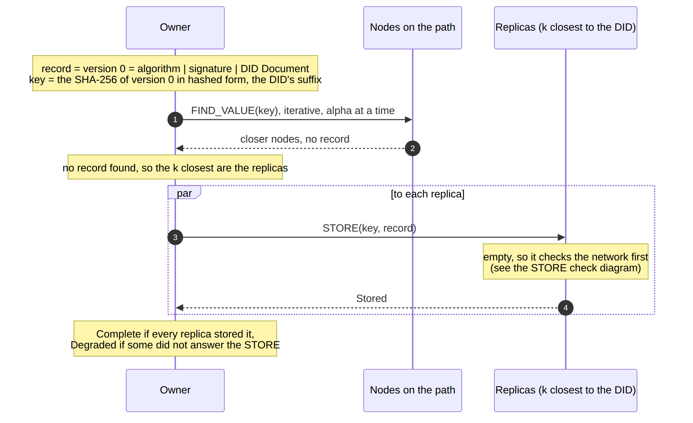

*Source: [`docs/design/publish.mmd`](docs/design/publish.mmd).*

SET publishes version 0 of a new DID; a later version passed to it is refused
locally, and goes through UPDATE (section 9). The owner first looks the key
up. If the network already holds a different valid record, publication is
refused. Otherwise the record is sent as STORE to the `k` closest nodes that
answered the lookup, the owner included if it is one of them. The lookup
leaves no copy on the nodes it asked. The outcome is reported per replica:

- **Complete:** every replica stored the record. Replicas are the nodes that
  answered the lookup; a node that did not is not counted as one.
- **Degraded:** at least one replica stored it, but some did not answer the
  STORE or had no room.
- **Rejected:** a replica holds a different record or a later version of the
  DID (counted apart, `stale_rejections`, `newer_claimed`), the record is
  invalid, or no replica stored it.

A retry of the same record is safe: replicas that already hold it answer
`AlreadyStored`, and the retry completes the ones that missed it.

## 7. Storing at a replica (STORE)

A replica that already holds a record for the key decides on its own, with
what it holds (ADR 0005, section 3):

- **The same bytes:** `AlreadyStored`, nothing verified or written (R1).
- **The next version:** its `prev` is the hash of the stored record and its
  signing key hashes to the stored `nextKeyHash`. Once its signature verifies
  it replaces the stored record, by a compare and swap that fails if the record
  changed meanwhile (R3). STORE and UPDATE follow the same rule.
- **An older version:** `Stale`. **Another version with the stored `seq`:**
  `Conflict`; when it is signed by the same key as the stored one, the owner
  signed two versions, which is logged as duplicity (R4).
- **A version further ahead:** `MissingPrevious`, and nothing is asked: the
  owner's replay brings the versions in between.

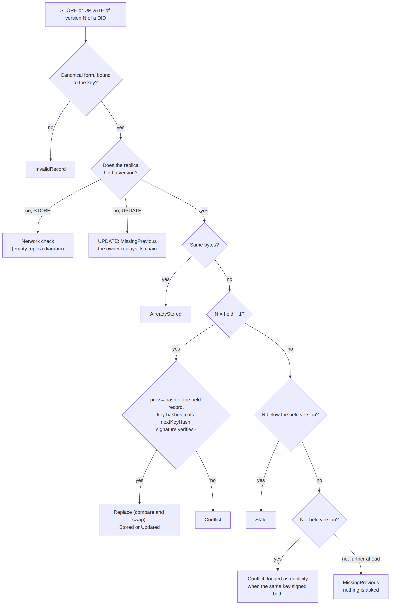

*Source: [`docs/design/replica-rules.mmd`](docs/design/replica-rules.mmd).*

An empty replica has a problem: it cannot check a later version against the
one before it, which it does not hold. "First writer wins" would protect
whoever arrives first: in the testbed, before the check, an attacker that read
an UPDATE and raced a forged STORE to a replica that had just restarted won 16
to 17 rounds out of 20 on WAN profiles. So an empty replica asks the network
before storing:

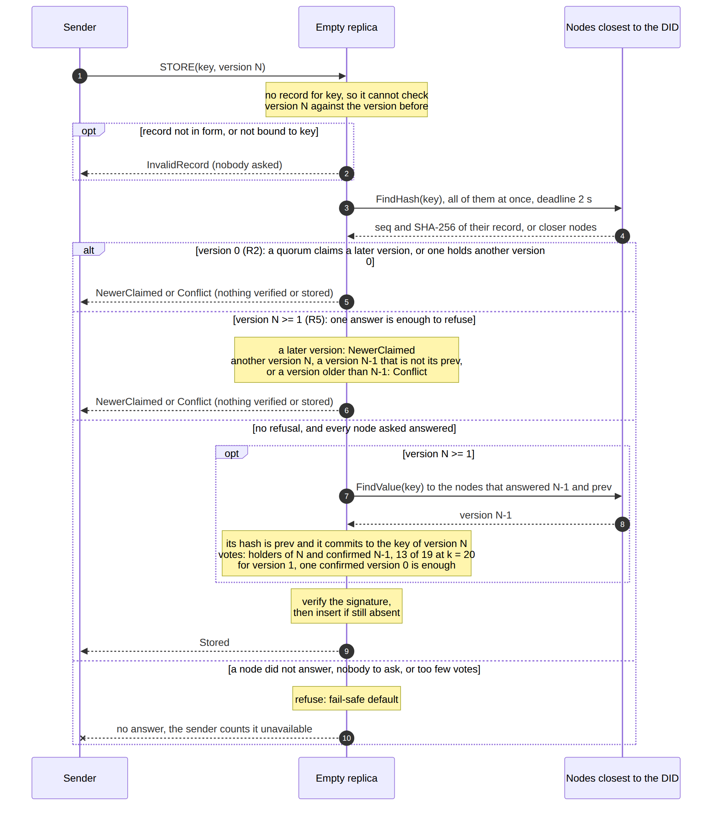

*Source: [`docs/design/store-check.mmd`](docs/design/store-check.mmd).*

1. It checks the form and binding of section 3, without the signature. A record
   that does not belong to the key is `InvalidRecord`, and nobody is asked: a
   malformed STORE does not cost a lookup.
2. It sends `FindHash` to the nodes closest to the key, asking for the `seq` and
   SHA-256 of the record they hold, all of them rather than
   stopping at the first answer, and leaves no cached copy behind. A replica
   asks them all at once, not three at a time as a GET does: it must hear all
   of them anyway, and a node asked late could be pushed out of the lookup by
   made-up nodes closer to the key in an earlier answer. A node that knows `k`
   nodes closer to the key than itself is not a replica and keeps three at a
   time.
3. **Version 0 (R2):** it refuses when a quorum of the nodes asked holds a later
   version (`NewerClaimed`), so that a single holder of a later version cannot
   stop the owner's replay, and when one holds another version 0 (`Conflict`).
   Otherwise, once every node asked has answered, it verifies the signature and
   stores the record.
4. **Version N ≥ 1 (R5):** one answer is enough to refuse: a later version,
   another version N, a version N−1 that is not its `prev`, or a version older
   than N−1, a holder that is behind. Otherwise it fetches version N−1 from the
   nodes that answered with it (one whole record), and checks that it is the
   `prev` and commits to the new version's key. It stores the record when the
   nodes that hold version N or a confirmed version N−1 reach the quorum,
   `max(2, min(n, ⌈(n + f + 1)/2⌉))` of the `n` nodes asked, with
   `f = max(1, ⌊(n − 1)/3⌋)`: 13 of 19 at `k = 20`. For a version 1, one
   fetched version 0 is enough, since version 0 proves its own binding. Nobody
   holding the key gives no votes, so it refuses.
5. **A node did not answer within 2 s, or it knows nobody to ask:** it refuses
   and sends no answer, so the sender counts it as unavailable.

**Why hashes, not records.** A node holding the record answers with its
SHA-256, 32 bytes in one datagram, instead of a whole record, about 6.5 KB in
five fragments. With records, every check cost about `k` records, and a burst of forged
STOREs made the replica receive more fragmented answers from the same holder
than its reassembly limit allows, so it dropped them. A hash cannot be
verified, so a node can block a STORE by claiming a later or another version.
It can block it just as well by staying silent, so this gives it no new power;
to make the replica accept a forged version it needs a quorum of the nodes
asked, and one honest holder among them refuses it. SHA-256 resists second
preimages, so a forged record cannot have the hash of the genuine one. R5
fetches one whole record, the version before, only after the hashes allow it.

**Why refuse on silence.** This is the fail-safe default of Saltzer and
Schroeder [Saltzer 1975]: base access decisions on permission rather than
exclusion. The opposite choice is the known flaw of soft-fail certificate
revocation checks, where a browser that cannot reach the revocation server
accepts the certificate, and an attacker who can block that request makes the
check pass. Langley calls it "a seat-belt that snaps when you crash"
[Langley 2012]. The fix there is a hard failure, as with OCSP Must-Staple
[RFC 7633]. It was not only theoretical here: a version that accepted on
silence stored up to 86 of 128 forged records under a burst. Nobody to ask
counts as silence too: in the testbed, a node that had just restarted and
treated "nobody to ask" as "nobody holds it" accepted forged records 6 times
in 20.

**What it costs.** One lookup per STORE at an empty replica, small answers
only. The first STORE after a node dies is refused by every replica that still
asks it, and a retry succeeds. A STORE to an empty replica takes a few
round trips longer.

**What it does not do.** It is a read before write without consensus.
Databases that need a strict "insert if absent" across replicas run a
consensus round instead, such as Cassandra's lightweight transactions
[Cassandra LWT]. A first publication needs no race protection any more: a
forged version 0 cannot bind to the DID, and a forged version 1 right after it
is refused, since the version 0 it would follow does not commit to its key.
It does not help against an attacker who controls a quorum of the nodes close
to the DID. It hears every node the replica knows, not every node that exists:
a node that answers with made-up nodes closer to the key can still push out of
the lookup a holder the replica learns of only from another answer, before it
is asked. And an answer counts for the node whose address it comes from:
message ids are drawn at random for each request, so a node that does not read
the traffic cannot answer for another, but one that reads it can.

The check runs outside the workers that read incoming datagrams (section 12),
because the answers to its own lookup arrive through those workers. Run on a
worker, 8 such STOREs at once left their lookups without answers.

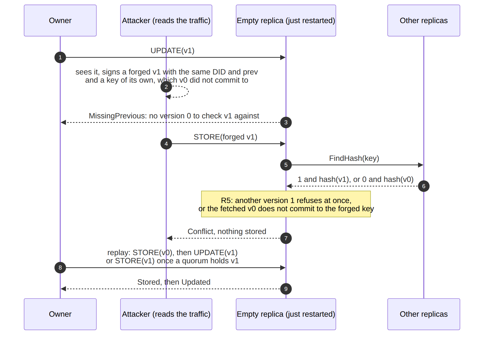

*Source: [`docs/design/attack.mmd`](docs/design/attack.mmd).*

## 8. Reading (GET)

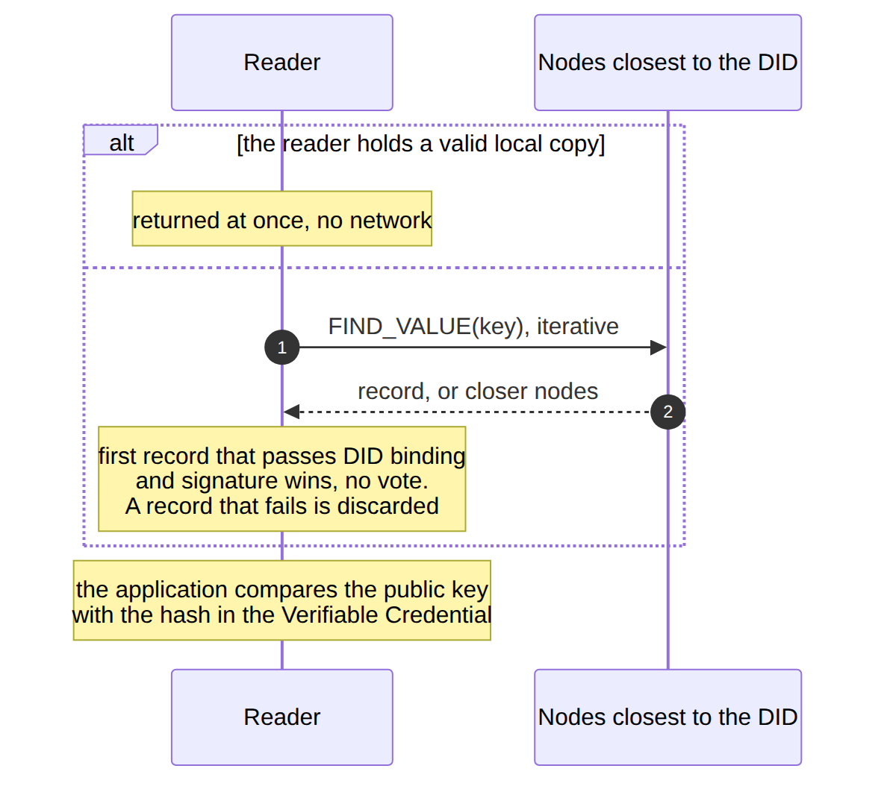

*Source: [`docs/design/get.mmd`](docs/design/get.mmd).*

A node that holds a valid copy returns it at once. Otherwise it runs the
Kademlia value lookup and, as in Kademlia §2.3, stops at the first record that
passes the DID binding and signature checks. A record that fails is discarded
and the lookup goes on, so one bad replica cannot end a read.

There is no vote among replicas. A vote does not establish authenticity: two
colluding nodes win it, and a stale replica that missed an update passes it as
well as the current one. A GET therefore proves that the record is consistent,
not that it is current or the owner's. **The application must compare the
public key with the hash in the Verifiable Credential.**

## 9. Key rotation (UPDATE)

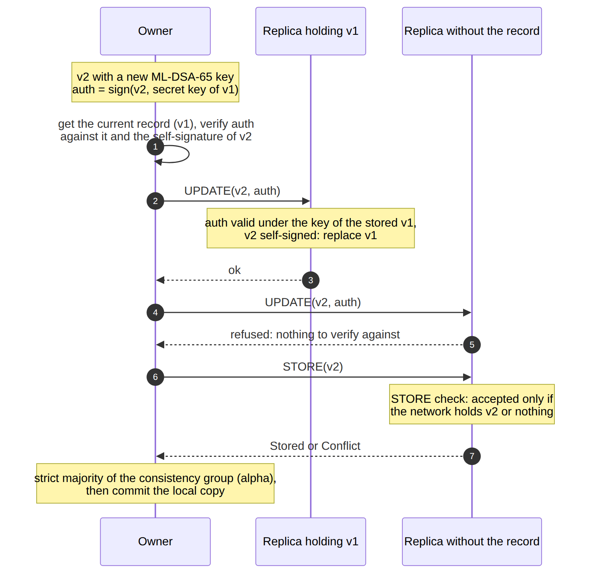

*Source: [`docs/design/update.mmd`](docs/design/update.mmd).*

A rotation replaces the ML-DSA-65 key, the only key of the document, and
needs new VCs. Key agreement between devices happens outside the DHT, with
ephemeral keys (ADR 0003), so no KEM key is published or rotated. Every
update is a rotation (ADR 0005): version N is signed by the key whose hash
version N−1 committed to, and commits to a new one. The device keeps that next
key as its 32-byte seed, in a secure element where it has one, until the
rotation that reveals it; a thief of the current key cannot rotate. This is
the pre-rotation of KERI [KERI]; the chain of versions, each authorized by the one
before, is the same idea as root key rotation in TUF [Samuel 2010].

1. The owner signs version N once and saves it, with every version before.
   It reads no copy first.
2. It sends `Update(vN)`, the record only, to the `k` closest nodes.
3. A replica holding version N−1 checks the new version on its own (section 7,
   R3): one hash of the stored record, one hash of the new key, one signature.
4. A replica already holding version N answers `AlreadyStored` without
   verifying: retrying an applied update is safe, as for an idempotent request
   [RFC 9110 §9.2.2] [Hohpe 2003]. The retry must resend the same bytes: a
   second version N signed by the same key is refused as duplicity.
5. A replica that is behind, or holds nothing, answers `MissingPrevious`. The
   owner replays its chain to it, one version at a time and waiting for each
   answer: version 0 by STORE (R2 at an empty replica), the next ones by
   UPDATE, the replicas behind first and the empty ones after. If version 0 of
   a replay is refused because a quorum now holds a later version (a sibling
   replica was just repaired), it sends the current version once by STORE, for
   R5. Only `MissingPrevious` starts a replay, never a missing answer.
6. The update succeeds on a strict majority of a consistency group of `alpha`
   members: the local copy, if the owner is a replica, voted by the same rules
   against what it holds, and the closest remote replicas. Only then does the
   owner write its local copy.

An old version cannot be replayed as new: a holder refuses it by `seq` and
`prev` (`Stale`, `Conflict`), and an empty replica by R2 and R5, as long as a
quorum of the nodes it asks hold the record. Nothing rests on the key
changing, and nothing reads a clock.

The owner keeps every version it published and sends its current version
again at least once every 24 hours: holders alone cannot bring a record back
once fewer than the quorum hold it, since R5 needs that many answers, while
the owner's replay needs none.

## 10. Status List

The Status List lists revoked credentials and is signed by the issuer with
ML-DSA-65, whose raw public key (1952 bytes) every node reads from
`issuer.bin`. Because it changes more often
than DID Documents, reads use a quorum: with `alpha = 3`, two byte-identical
copies out of at most three, the local copy counting as one. A split with no
majority returns nothing. The issuer updates it with `UpdateStatusList`. It is
exempt from the STORE check of section 7, which is about self-signed records.

## 11. Replication, churn and expiry

- **New nodes** receive the records they become responsible for (Kademlia
  §2.5): when a node learns of a new contact, it sends that contact the records
  for which the contact is now among the closest and this node is the closest.
  These STOREs go through the check of section 7. Finding those records means
  scanning the whole storage, so new nodes wait for their records in a queue,
  one at a time (section 12). A node beyond the queue's bound is still added
  to the routing table and gets its records from the next republication.
- **Returning nodes**, silent for at least 2.5 s, are treated as new and
  refilled the same way. A node that crashes and restarts within about a second
  is not noticed by its neighbours, and stays empty until a republication
  (`EXPERIMENTS.md`, A2).
- **Republication:** every hour each node sends records older than an hour to
  the `k` closest nodes, which also refills replicas that came back empty.
  These STOREs pass the check of section 7 only while a quorum of the nodes
  asked hold the record.
- **The owner's republication:** at least every 24 hours, and whenever it comes
  back online, the owner sends its current version again with the saved bytes,
  replaying its chain to every replica that is empty or behind. Version 0 needs
  no votes and each later version is checked against the one before, so the
  owner restores copies below the quorum, where the holders cannot
  (`EXPERIMENTS.md`, L2: with the owner offline, the holders refilled the
  empty replicas while 13 of 20 remained and none below; the owner's return
  restored them all).

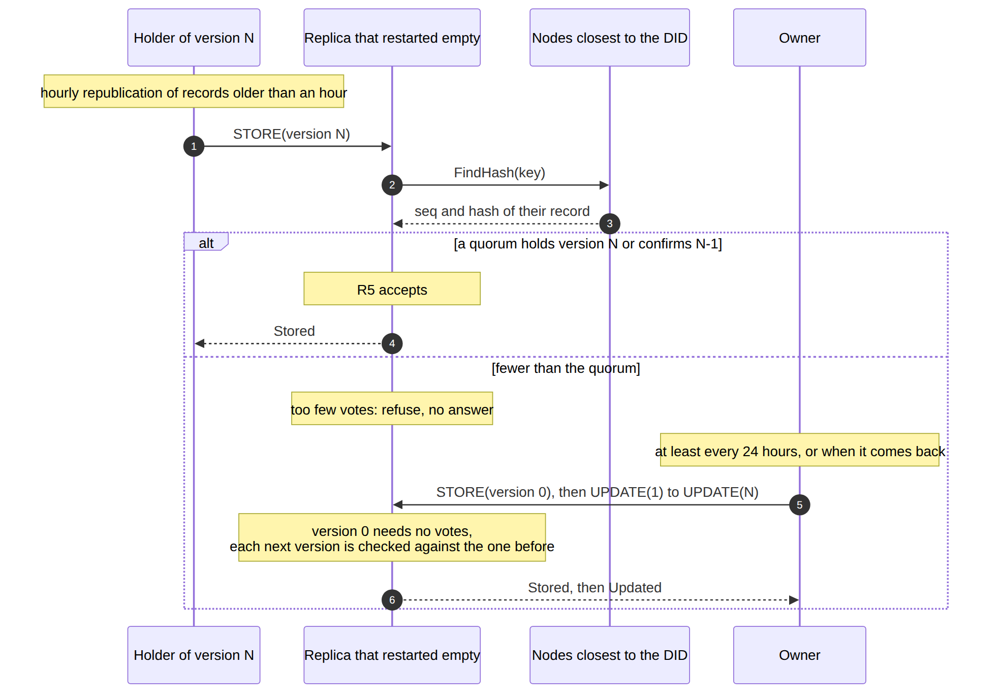

*Source: [`docs/design/repair.mmd`](docs/design/repair.mmd).*
- **Expiry:** records expire 14 days after they were written. There is no
  delete. An application that needs a record to stay must publish or update it
  before then.

## 12. Concurrency and resource bounds

- One task reads the socket and hands datagrams round-robin to one worker per
  core. When every worker's queue is full, reading waits instead of dropping.
- Signature verification runs on a blocking pool capped at the number of cores,
  so that a small ARM board is not swamped by threads. The caller builds the
  Tokio runtime with that cap.
- A STORE that needs the check of section 7 runs in its own task, at most 256
  at once. Beyond that the STORE is dropped, as an overloaded node drops
  datagrams.
- Storage holds at most 512 MiB by default and never evicts a live record to
  make room: a full node answers `CapacityExceeded`.
- Sending new nodes their records (section 11) scans the whole storage, so one
  scan runs at a time and at most 256 nodes wait for it. The bound is on the
  records, not on the routing table: a node met beyond it is still added. The
  scan reads the routing table 256 records at a time, so a node making contact
  meanwhile does not wait for the whole scan to enter the table.
- The routing table sits behind Tokio's `RwLock`, which is fair: a waiting
  writer goes before readers that come after it. A value lookup (a DID read,
  and the check of section 7) therefore runs each request to a peer as its own
  task. Between two answers the lookup reads or writes the table, and a request
  may be waiting to write it, because a node met in an answer enters the table.
  If the lookup polled its requests itself, it would stop polling them while it
  waits for the table. The lock would then be handed to a request nobody polls,
  and the whole node would stop. This is the "futurelock" of [Oxide RFD 609],
  which recommends a `JoinSet` for such sets of requests. It happened in the
  testbed with 127 nodes, `k = 20`: a node stopped answering two seconds after
  the first publication. Lookups that wait for every answer of a round before
  touching the table (`join_all`) are not affected.

## 13. Known limits

- **`FindHash` is not understood by older nodes**, and the check refuses on
  silence, so mixed-version networks refuse STOREs to empty replicas. Nodes
  before and after ADR 0005 cannot talk at all.
- **One node can keep an empty replica empty** (ADR 0005, Consequences). One
  answer that claims a later version, or one silent node, refuses a later
  version at an empty replica, at any number of holders; with one persistent
  liar near a DID the number of copies can only fall (`EXPERIMENTS.md`, A4
  and L1). A refusal that had to show its evidence would remove this veto; it
  is a later ADR.
- **The check counts answers, so its safety assumes** that an answer comes
  from the node it names (a node that reads the traffic sees every message id
  and can answer for another), that node ids cannot be chosen (a quorum of
  admitted nodes could place themselves next to one DID), and that the
  replica knows enough contacts (a restarted replica asks few nodes and needs
  few votes).
- **A forgery accepted at an empty replica stays there** until it expires: the
  genuine chain is refused there as a fork. It needs a quorum of colluders
  among the nodes asked and no honest holder among them.
- **Below the quorum, an old version can be pinned at an empty replica** by
  replaying the genuine chain up to it, and a thief of a revealed key can sign
  another version M and get it onto a replica holding M−1 or nothing; holders
  of version M or later refuse it. The owner's replay moves a pinned replica
  on, not a fork.
- **A lost next key ends the DID:** no further rotation, as with a lost key
  before. A next seed suspected of having leaked has one answer: rotate with it
  at once.

## 14. How behaviour is measured

`testbed/` runs one node per Docker container, with latency and loss emulated
by `tc netem` from published backbone measurements (LAN, WAN Europe, WAN
Trans-Atlantic), and an attacker that reads all the containers' traffic. It
sends forged versions (the owner's DID and `prev`, its own key): one per
UPDATE (`race`), many at once (`burst`), a version 1 right after each version
0 (`successor`), or to every node all the time (`persist`); and it can answer
`FindHash` for other nodes under guessed ids (`spoof`). A testbed-only switch
makes chosen nodes lie in `FindHash`. Measurement modes time publications,
rotations with replicas restarted empty, and count copies over time under
churn. See
`testbed/README.md` for the commands, and `EXPERIMENTS.md` for the experiments
that validate the current code and their results.

## 15. References

- [Birrell 1984] A. D. Birrell and B. J. Nelson, "Implementing Remote Procedure
  Calls", *ACM Transactions on Computer Systems* 2(1), 1984.
- [Cassandra LWT] DataStax, "Lightweight transactions", Apache Cassandra 2.1
  documentation. https://docs.datastax.com/en/cassandra-oss/2.1/cassandra/dml/dml_ltwt_transaction_c.html
- [FIPS 204] NIST, "Module-Lattice-Based Digital Signature Standard", FIPS
  204, August 2024.
- [Hohpe 2003] G. Hohpe and B. Woolf, *Enterprise Integration Patterns*,
  Addison-Wesley, 2003, "Idempotent Receiver".
- [Karn 1987] P. Karn and C. Partridge, "Improving Round-Trip Time Estimates in
  Reliable Transport Protocols", ACM SIGCOMM 1987.
- [KERI] Trust over IP, "Key Event Receipt Infrastructure (KERI)", v1.1,
  "Pre-rotation". https://trustoverip.github.io/kswg-keri-specification/
- [Langley 2012] A. Langley, "Revocation checking and Chrome's CRL", 5 February
  2012. https://www.imperialviolet.org/2012/02/05/crlsets.html
- [Maymounkov 2002] P. Maymounkov and D. Mazières, "Kademlia: A Peer-to-peer
  Information System Based on the XOR Metric", IPTPS 2002.
- [Oxide RFD 609] Oxide Computer Company, "Futurelock", RFD 609, 2025.
  https://rfd.shared.oxide.computer/rfd/0609
- [RFC 6298] V. Paxson, M. Allman, J. Chu and M. Sargent, "Computing TCP's
  Retransmission Timer", RFC 6298, 2011.
- [RFC 7633] P. Hallam-Baker, "X.509v3 Transport Layer Security (TLS) Feature
  Extension", RFC 7633, 2015.
- [RFC 9110] R. Fielding, M. Nottingham and J. Reschke, "HTTP Semantics",
  RFC 9110, 2022, §9.2.2 "Idempotent Methods".
- [RFC 9964] "ML-DSA for JOSE and COSE", RFC 9964, May 2026.
- [Saltzer 1975] J. H. Saltzer and M. D. Schroeder, "The Protection of
  Information in Computer Systems", *Proceedings of the IEEE* 63(9), 1975.
- [Samuel 2010] J. Samuel, N. Mathewson, J. Cappos and R. Dingledine,
  "Survivable Key Compromise in Software Update Systems", ACM CCS 2010.
- [Trungadi 2025] F. Trungadi et al., "Securing Modbus in legacy industrial
  control systems: A decentralized approach using Proxies, Post-Quantum
  Cryptography and Self-Sovereign Identity", *Journal of Information Security
  and Applications* 94 (2025) 104199. https://doi.org/10.1016/j.jisa.2025.104199
