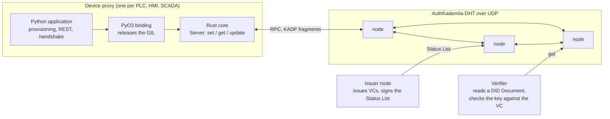
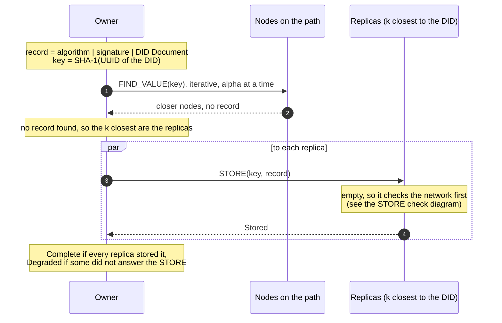
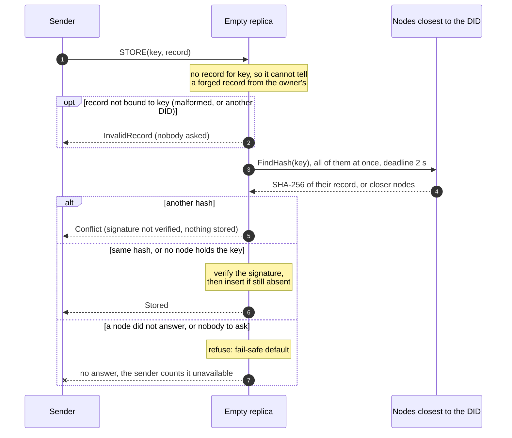
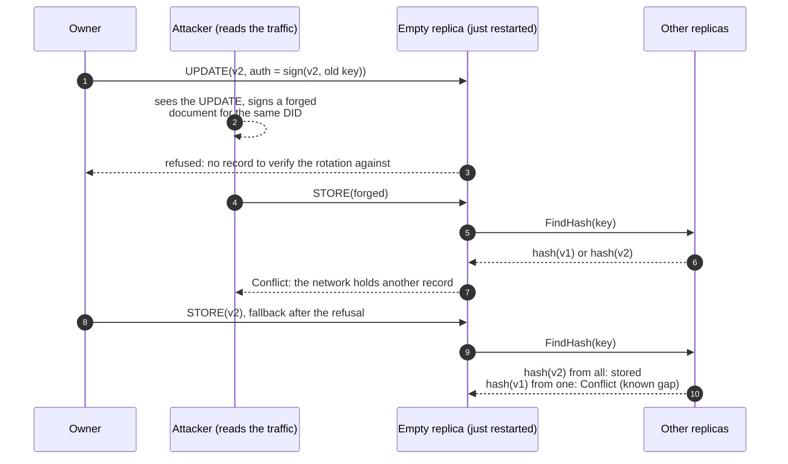
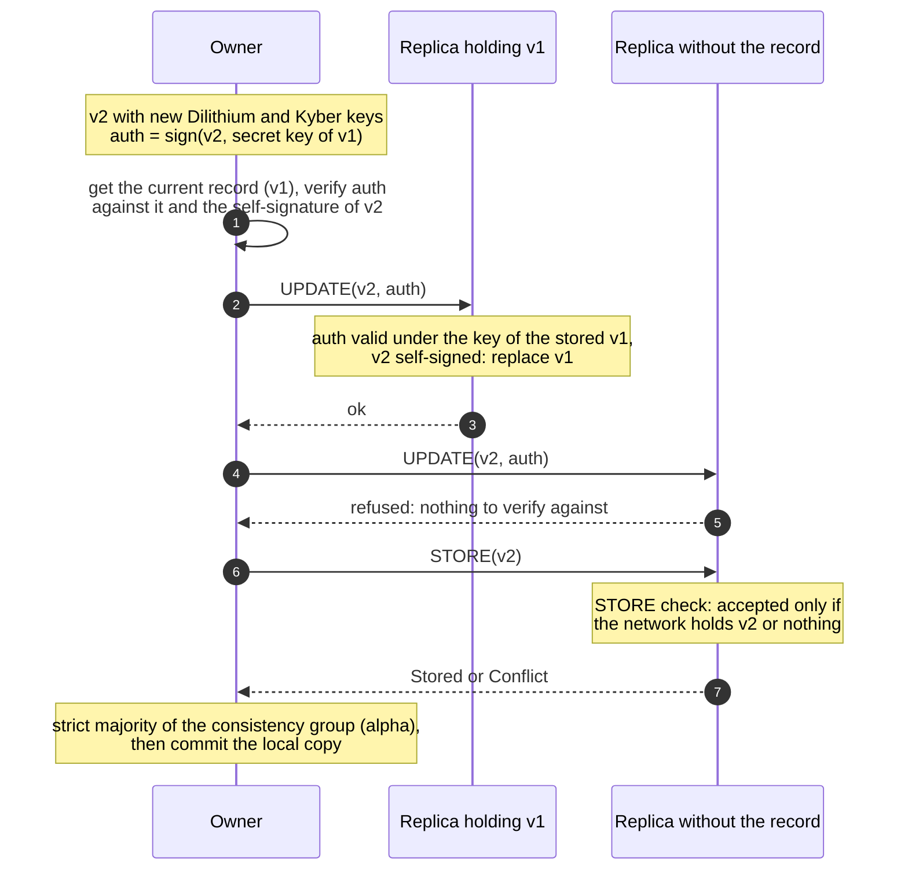

# AuthKademlia-RS design

This document explains how AuthKademlia-RS works and why: what a node stores,
how records are published, read and rotated, and what each choice defends
against. It describes the protocol, not the API: see `README.md` for usage and
`AGENTS.md` for the code map. The diagrams are Mermaid blocks, which GitHub
draws; the same sources are in `docs/design/`.

## Contents

1. [Purpose](#1-purpose)
2. [Threat model](#2-threat-model)
3. [Identifiers and records](#3-identifiers-and-records)
4. [Transport](#4-transport)
5. [Routing](#5-routing)
6. [Publication (SET)](#6-publication-set)
7. [Storing at a replica (STORE)](#7-storing-at-a-replica-store)
8. [Reading (GET)](#8-reading-get)
9. [Key rotation (UPDATE)](#9-key-rotation-update)
10. [Status List](#10-status-list)
11. [Replication, churn and expiry](#11-replication-churn-and-expiry)
12. [Concurrency and resource bounds](#12-concurrency-and-resource-bounds)
13. [Known limits](#13-known-limits)
14. [How behaviour is measured](#14-how-behaviour-is-measured)
15. [References](#15-references)

## 1. Purpose

AuthKademlia is the Verifiable Data Registry (VDR) of the `did:iiot` method,
the identity layer of a security architecture for legacy industrial control
systems [Trungadi 2025]. Every device gets a proxy; every proxy has a DID whose
DID Document, holding its post-quantum public keys, is stored in the DHT.
Peers read each other's DID Documents to run an authenticated key exchange
(Dilithium signatures, Kyber key encapsulation). An issuer node issues
Verifiable Credentials (VCs) and signs a Status List of revocations.

The DHT is Kademlia [Maymounkov 2002] with one change that shapes everything
else: **a node stores a value only if it is an authenticated record**, a DID
Document signed by the key it contains, or the Status List signed by the
issuer.



The Rust core holds the network and the cryptography. Dilithium verification is
CPU-bound (about 5 ms on x86, more on ARM boards), and the Python binding
releases the GIL so that all cores can verify in parallel. Application logic
stays in Python.

## 2. Threat model

The DHT must hold up against:

- **A network attacker** who reads all traffic and sends packets of its own,
  from as many ports as it likes, next to any node. In the testbed this
  attacker cannot modify or drop the owner's packets. If it could, it would
  still not forge a signature, but it could deny service.
- **Malicious nodes** that answer requests with anything, or not at all.
- **Forged records**: anyone can generate a key pair and sign a DID Document
  for any DID, because a DID is a random UUID, not derived from a key. The
  signature proves that the document is consistent, not that it belongs to the
  device.

Out of scope for the DHT, by design:

- **Who owns a DID.** The binding between a DID and its key is the
  Verifiable Credential: the application compares the public key in the DID
  Document with the hash in the VC. A reader that skips that check can be given
  a forged document (section 8).
- **An attacker who controls every node close to a DID.** It decides what that
  DID resolves to. Kademlia's defences against such eclipse attacks (many
  disjoint lookups, costly node ids) are not implemented.

The DID is kept separate from the key on purpose: a key-derived DID would make
forgery impossible but would change identity at every key rotation.

## 3. Identifiers and records

| Item | Definition |
|---|---|
| Node id | 160 bits. Distance is the XOR of the full 160 bits, never folded |
| DHT key of a DID | `SHA-1(uuid)`, where the DID is `did:iiot:<uuid>` |
| DHT key of the Status List | `SHA-1("status-list")` |
| Record | `algorithm (12 B) | signature | DID Document (canonical JSON)` |

The algorithm field selects the verifier: Dilithium-2, 3 or 5, Ed25519 or RSA.
A record is accepted for a key only if:

1. **DID binding:** the document's `id` is `did:iiot:<uuid>`, the UUID parses,
   and `SHA-1(uuid)` is the key. Without this check a valid record could be
   stored under any key.
2. **Signature:** the signature verifies over the canonical JSON with the
   public key the document itself declares.

A verification result can be cached under the SHA-256 of the record (one hour,
4096 entries). A cache miss is a full verification, never a bypass.

## 4. Transport

Nodes talk over UDP. A message is a `bincode` envelope
`(message id, is request, message)`. Requests and answers are matched by
message id and by the peer's address, and an answer of the wrong type is
discarded.

Post-quantum records are about 6 KB, more than one datagram, so every message
is split into fragments of at most 1400 bytes with a 12-byte header (`KADF`,
fragment id, index, total). Reassembly is bounded: at most 256 KB per message,
64 partial messages in all, 8 per peer, kept 10 s. These limits protect memory.
They also mean that a node receiving many large answers from the same peer at
once drops some: section 7 explains why the STORE check avoids large answers.

| Request | Answer | Purpose |
|---|---|---|
| `Ping` | `Pong` | Liveness and discovery |
| `FindNode` | `FindNodeResult` | The closest nodes to a key |
| `FindValue` | `FindValueHit` or `FindValueNodes` | A record, or closer nodes |
| `FindHash` | `FindHashHit` or `FindValueNodes` | The SHA-256 of the record a node holds (section 7) |
| `Store` | `Received`, then `StoreResult` | Store a record if absent |
| `Update` | `Received`, then `UpdateResult` | Key rotation (section 9) |
| `UpdateStatusList` | `Received`, then `UpdateStatusListResult` | New Status List from the issuer |
| `Leave` | none | Graceful departure |

A request waits at most 2.5 s for its answer. UDP loses datagrams, so a
request with no sign of its peer after a few round trips is sent again, the
same datagrams with the same message id, at most twice, waiting twice as long
each time. The wait is three round trips of that peer, or the smoothed round
trip plus four times its variation if that is longer (RFC 6298), between 20 ms
and 1 s, and 500 ms for a peer never measured. A round trip is measured only
on a request sent once, since the answer to a resent one could belong to
either copy (Karn's algorithm).

A request that carries a record is answered only once the record is handled,
which at an empty replica includes the network check of section 7, two or
three round trips. Such a request gets a receipt, `Received`, as soon as it
arrives. The sender then does not resend the record while it waits, and a
later copy only asks for an answer that may have been lost: a replica that has
stored the record answers it at once with "already stored". A copy that
arrives while the request is still being handled is recognised (same sender,
same bytes) and gets the receipt again, without a second check. This is the
classic scheme of remote procedure calls over datagrams (Birrell and Nelson,
1984): retransmission, acknowledgement of long calls, suppression of
duplicates.

Without resends a single lost datagram cost the whole 2.5 s timeout, and in
the STORE check it also made the replica refuse (section 7). Measured with
0.5% loss, 30 nodes and k=5, 26 of 80 publications lost a replica with the
check alone and none of 80 with resends (section 14).

`FindHash` and `Received` are the newest messages: nodes that do not know them
cannot decode them, so all nodes of a network must run a version that does.

## 5. Routing

The routing table is Kademlia's: k-buckets over the 160-bit space, split when
they cover the node's own id or when the depth is not a multiple of 5. A
lookup asks `alpha` nodes at a time and moves towards the key until the `k`
closest nodes it knows have all answered. Defaults: `k = 20`, `alpha = 3`.

A node that sends a message enters the routing table at once (Kademlia §2.2),
however busy the node is sending records to other new nodes (section 11). When
its bucket is full and cannot split, the bucket's oldest contact is pinged to
learn whether it is still there, and the newcomer waits in the replacement
list. That ping runs once at a time per contact, so a flood of made-up
identities does not turn every message into a ping. Until November 2026 a node
met while another was being sent its records was dropped instead. A lookup
would usually find it again in a large network, but not in a small one: after
one bootstrap pass of 30 nodes with `k = 20`, half of the nodes knew at most
20-22 of the 29 others, against 26-27 now.

Unresponsive contacts follow Kademlia §4.1 rather than being dropped at the
first timeout. A failure starts an exponential backoff (5 s to 300 s), and
after 5 failures in a row the contact is stale: it is replaced if a replacement
exists, otherwise kept but not advertised. Any answer clears the failures. A
lookup does not re-ask a peer that failed during it, nor a peer this node knows
is failing, even when other nodes keep reporting it. A once-per-second
maintenance tick pings failing contacts whose backoff has elapsed and, when the
node has no live contact, retries its bootstrap seeds.

## 6. Publication (SET)



The owner first looks the key up. If the network already holds a different
valid record, publication is refused: records are immutable once created, and
a new version must go through UPDATE. Otherwise the record is sent as STORE to
the `k` closest nodes that answered the lookup, the owner included if it is one
of them. The outcome is reported per replica:

- **Complete:** every replica stored the record. Replicas are the nodes that
  answered the lookup; a node that did not is not counted as one.
- **Degraded:** at least one replica stored it, but some did not answer the
  STORE or had no room.
- **Rejected:** a replica holds a different record, the record is invalid, or
  no replica stored it.

A retry of the same record is safe: replicas that already hold it answer
`AlreadyStored`, and the retry completes the ones that missed it.

## 7. Storing at a replica (STORE)

A replica that already holds a record for the key compares bytes: the same
record is `AlreadyStored`, a different one is `Conflict`. The first writer wins,
and a record is never overwritten by STORE.

An empty replica has a problem: it cannot tell a forged record from the
owner's, because both are self-signed for the same DID. "First writer wins"
then protects whoever arrives first. In the testbed, an attacker that read an
UPDATE and raced a forged STORE to a replica that had just restarted won 16 to
17 rounds out of 20 on WAN profiles. So an empty replica asks the network
before storing:



1. It checks the DID binding of section 3, a JSON parse. A record that does not
   belong to the key is `InvalidRecord`, and nobody is asked: a malformed
   STORE does not cost a lookup.
2. It sends `FindHash` to the nodes closest to the key, all of them rather than
   stopping at the first answer, and leaves no cached copy behind. A replica
   asks them all at once, not three at a time as a GET does: it must hear all
   of them anyway, and a node asked late could be pushed out of the lookup by
   made-up nodes closer to the key in an earlier answer. A node that knows `k`
   nodes closer to the key than itself is not a replica and keeps three at a
   time.
3. **Another hash:** it answers `Conflict` without verifying the signature.
4. **The same hash, or no node holds the key:** it verifies the signature and
   stores the record.
5. **A node did not answer within 2 s, or it knows nobody to ask:** it refuses
   and sends no answer, so the sender counts it as unavailable.

**Why hashes, not records.** A node holding the record answers with its
SHA-256, 32 bytes in one datagram, instead of about 6 KB in five fragments.
With records, every check cost about `k` times 6 KB, and a burst of forged
STOREs made the replica receive more fragmented answers from the same holder
than its reassembly limit allows, so it dropped them. A hash cannot be
verified, so a node can block a STORE by answering with a wrong hash. It can
block it just as well by staying silent, so this gives it no new power, and it
cannot make the replica accept anything. SHA-256 resists second preimages, so
a forged record cannot have the hash of the genuine one.

**Why refuse on silence.** This is the fail-safe default of Saltzer and
Schroeder [Saltzer 1975]: base access decisions on permission rather than
exclusion. The opposite choice is the known flaw of soft-fail certificate
revocation checks, where a browser that cannot reach the revocation server
accepts the certificate, and an attacker who can block that request makes the
check pass. Langley calls it "a seat-belt that snaps when you crash"
[Langley 2012]. The fix there is a hard failure, as with OCSP Must-Staple
[RFC 7633]. It was not only theoretical here: a version that accepted on
silence stored up to 86 of 128 forged records under a burst. Nobody to ask
counts as silence too: in the testbed, a node that had just restarted and
treated "nobody to ask" as "nobody holds it" accepted forged records 6 times
in 20.

**What it costs.** One lookup per STORE at an empty replica, small answers
only. The first STORE after a node dies is refused by every replica that still
asks it, and a retry succeeds. A STORE to an empty replica takes a few
round trips longer.

**What it does not do.** It is a read before write without consensus: two
STOREs racing for a key that no node holds yet can both pass, and the first
writer wins as before. Databases that need a strict "insert if absent" across
replicas run a consensus round instead, such as Cassandra's lightweight
transactions [Cassandra LWT]. It does not protect a first publication, when
the network holds nothing yet: an attacker who learns a UUID before the owner
publishes it can publish first, and one that sees the owner's first STOREs can
race them to nodes that do not hold the record yet. It does not help against an attacker who
controls every node close to the DID.

The check runs outside the workers that read incoming datagrams (section 12),
because the answers to its own lookup arrive through those workers. Run on a
worker, 8 such STOREs at once left their lookups without answers.



## 8. Reading (GET)

```mermaid
sequenceDiagram
    autonumber
    participant V as Reader
    participant N as Nodes closest to the DID
    alt the reader holds a valid local copy
        Note over V: returned at once, no network
    else
        V->>N: FIND_VALUE(key), iterative
        N-->>V: record, or closer nodes
        Note over V: first record that passes DID binding<br/>and signature wins, no vote;<br/>a record that fails is discarded
    end
    Note over V: the application compares the public key<br/>with the hash in the Verifiable Credential
```

A node that holds a valid copy returns it at once. Otherwise it runs the
Kademlia value lookup and, as in Kademlia §2.3, stops at the first record that
passes the DID binding and signature checks. A record that fails is discarded
and the lookup goes on, so one bad replica cannot end a read.

There is no vote among replicas. A vote does not establish authenticity: two
colluding nodes win it, and a stale replica that missed an update passes it as
well as the current one. A GET therefore proves that the record is consistent,
not that it is current or the owner's. **The application must compare the
public key with the hash in the Verifiable Credential.**

## 9. Key rotation (UPDATE)



A rotation replaces the Dilithium and Kyber keys together and needs new VCs.
The new record `v2` carries an authorization: `auth = sign(v2, secret key of
v1)`. The chain of authorizations, each new version signed by the previous
key, is the same idea as root key rotation in TUF [Samuel 2010].

1. The owner reads the current record, checks the authorization against it,
   and checks that `v2` is self-signed.
2. It sends `Update(v2, auth)` to the `k` closest nodes.
3. A replica holding `v1` verifies `auth` with the key in its stored `v1` and
   replaces the record.
4. A replica holding `v2` already acknowledges without verifying: retrying an
   applied update is safe, as for an idempotent request [RFC 9110 §9.2.2]
   [Hohpe 2003]. The retry must resend the same bytes.
5. A replica without the record has nothing to verify against and refuses. The
   owner then sends it `v2` as STORE, which passes the check of section 7 only
   if the network holds `v2` or nothing.
6. The update succeeds on a strict majority of a consistency group of `alpha`
   members: the local copy, if the owner is a replica, and the closest remote
   replicas. Only then does the owner commit its local copy.

As long as every update changes the key, an old record cannot be replayed as
"new": that would need a signature by the newer key. An update that keeps the
key could be replayed.

## 10. Status List

The Status List lists revoked credentials and is signed by the issuer, whose
public key every node reads from `issuer.bin`. Because it changes more often
than DID Documents, reads use a quorum: with `alpha = 3`, two byte-identical
copies out of at most three, the local copy counting as one. A split with no
majority returns nothing. The issuer updates it with `UpdateStatusList`. It is
exempt from the STORE check of section 7, which is about self-signed records.

## 11. Replication, churn and expiry

- **New nodes** receive the records they become responsible for (Kademlia
  §2.5): when a node learns of a new contact, it sends that contact the records
  for which the contact is now among the closest and this node is the closest.
  These STOREs go through the check of section 7. Finding those records means
  scanning the whole storage, so new nodes wait for their records in a queue,
  one at a time (section 12). A node beyond the queue's bound is still added
  to the routing table and gets its records from the next republication.
- **Returning nodes**, silent for at least 2.5 s, are treated as new and
  refilled the same way.
- **Republication:** every hour each node sends records older than an hour to
  the `k` closest nodes, which also refills replicas that came back empty.
- **Expiry:** records expire 14 days after they were written. There is no
  delete. An application that needs a record to stay must publish or update it
  before then.

## 12. Concurrency and resource bounds

- One task reads the socket and hands datagrams round-robin to one worker per
  core. When every worker's queue is full, reading waits instead of dropping.
- Signature verification runs on a blocking pool capped at the number of cores,
  so that a small ARM board is not swamped by threads. The caller builds the
  Tokio runtime with that cap.
- A STORE that needs the check of section 7 runs in its own task, at most 256
  at once. Beyond that the STORE is dropped, as an overloaded node drops
  datagrams.
- Storage holds at most 512 MiB by default and never evicts a live record to
  make room: a full node answers `CapacityExceeded`.
- Sending new nodes their records (section 11) scans the whole storage, so one
  scan runs at a time and at most 256 nodes wait for it. The bound is on the
  records, not on the routing table: a node met beyond it is still added. The
  scan reads the routing table 256 records at a time, so a node making contact
  meanwhile does not wait for the whole scan to enter the table.
- The routing table sits behind Tokio's `RwLock`, which is fair: a waiting
  writer goes before readers that come after it. A value lookup (a DID read,
  and the check of section 7) therefore runs each request to a peer as its own
  task. Between two answers the lookup reads or writes the table, and a request
  may be waiting to write it, because a node met in an answer enters the table.
  If the lookup polled its requests itself, it would stop polling them while it
  waits for the table. The lock would then be handed to a request nobody polls,
  and the whole node would stop. This is the "futurelock" of [Oxide RFD 609],
  which recommends a `JoinSet` for such sets of requests. It happened in the
  testbed with 127 nodes, `k = 20`: a node stopped answering two seconds after
  the first publication. Lookups that wait for every answer of a round before
  touching the table (`join_all`) are not affected.

## 13. Known limits

- **`FindHash` is not understood by older nodes**, and the check refuses on
  silence, so mixed-version networks refuse STOREs to empty replicas.

## 14. How behaviour is measured

`testbed/` runs one node per Docker container, with latency and loss emulated
by `tc netem` from published backbone measurements (LAN, WAN Europe, WAN
Trans-Atlantic), and an attacker that reads all the containers' traffic. Its
modes are a forged STORE per UPDATE (`race`), many at once (`burst`), and
forged records sent to every node all the time (`persist`). A measurement
mode times publications and the moment other nodes can read the record. See
`testbed/README.md` for the commands and the recorded results.

## 15. References

- [Birrell 1984] A. D. Birrell and B. J. Nelson, "Implementing Remote Procedure
  Calls", *ACM Transactions on Computer Systems* 2(1), 1984.
- [Cassandra LWT] DataStax, "Lightweight transactions", Apache Cassandra 2.1
  documentation. https://docs.datastax.com/en/cassandra-oss/2.1/cassandra/dml/dml_ltwt_transaction_c.html
- [Hohpe 2003] G. Hohpe and B. Woolf, *Enterprise Integration Patterns*,
  Addison-Wesley, 2003, "Idempotent Receiver".
- [Karn 1987] P. Karn and C. Partridge, "Improving Round-Trip Time Estimates in
  Reliable Transport Protocols", ACM SIGCOMM 1987.
- [Langley 2012] A. Langley, "Revocation checking and Chrome's CRL", 5 February
  2012. https://www.imperialviolet.org/2012/02/05/crlsets.html
- [Maymounkov 2002] P. Maymounkov and D. Mazières, "Kademlia: A Peer-to-peer
  Information System Based on the XOR Metric", IPTPS 2002.
- [Oxide RFD 609] Oxide Computer Company, "Futurelock", RFD 609, 2025.
  https://rfd.shared.oxide.computer/rfd/0609
- [RFC 6298] V. Paxson, M. Allman, J. Chu and M. Sargent, "Computing TCP's
  Retransmission Timer", RFC 6298, 2011.
- [RFC 7633] P. Hallam-Baker, "X.509v3 Transport Layer Security (TLS) Feature
  Extension", RFC 7633, 2015.
- [RFC 9110] R. Fielding, M. Nottingham and J. Reschke, "HTTP Semantics",
  RFC 9110, 2022, §9.2.2 "Idempotent Methods".
- [Saltzer 1975] J. H. Saltzer and M. D. Schroeder, "The Protection of
  Information in Computer Systems", *Proceedings of the IEEE* 63(9), 1975.
- [Samuel 2010] J. Samuel, N. Mathewson, J. Cappos and R. Dingledine,
  "Survivable Key Compromise in Software Update Systems", ACM CCS 2010.
- [Trungadi 2025] F. Trungadi et al., "Securing Modbus in legacy industrial
  control systems: A decentralized approach using Proxies, Post-Quantum
  Cryptography and Self-Sovereign Identity", *Journal of Information Security
  and Applications* 94 (2025) 104199. https://doi.org/10.1016/j.jisa.2025.104199
