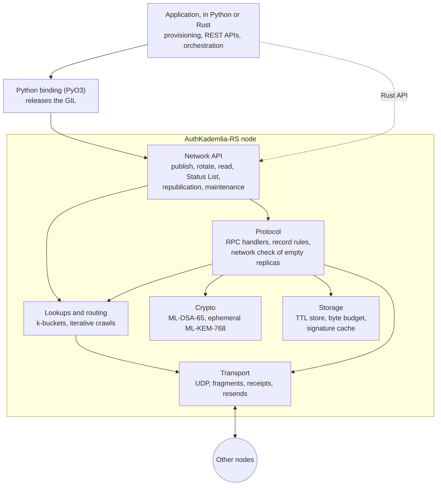

# AuthKademlia-RS

AuthKademlia-RS is a Rust implementation of AuthKademlia, a Kademlia
distributed hash table that stores only authenticated records. It serves as the
Verifiable Data Registry of the [`did:iiot`](https://github.com/fratrung/did-iiot)
Decentralized Identifier method for Industrial IoT: devices publish post-quantum
DID Documents to a peer-to-peer network, and every node verifies them without a
central authority.

## Contents

1. [Overview](#overview)
2. [Features](#features)
3. [Security model](#security-model)
4. [Architecture](#architecture)
5. [Getting started](#getting-started)
6. [Evaluation](#evaluation)
7. [Documentation](#documentation)
8. [Related projects](#related-projects)
9. [Citation](#citation)
10. [AI-assisted development disclosure](#ai-assisted-development-disclosure)
11. [License](#license)

## Overview

A Decentralized Identifier (DID) resolves to a DID Document that holds the
public key of its subject. In `did:iiot`, these documents are stored in a
distributed hash table rather than on a ledger or a web server, so that device
identities do not depend on any single operator.

A conventional DHT stores any value under any key. AuthKademlia-RS restricts
storage to records whose integrity and ownership every node can verify:

- every record is a DID Document signed with ML-DSA-65 (FIPS 204) by the key
  it declares;
- a DID is derived from the device's first DID Document, so that its
  identifier is self-certifying;
- each version of a document commits to the key that will sign the next one,
  so that updates are authorized by the chain of versions itself.

The implementation targets edge and embedded nodes: multi-core devices of low
per-core performance, where signature verification must use every core. It
reimplements the original Python [AuthKademlia](https://github.com/fratrung/AuthKademlia)
and exposes Python bindings for application logic.

## Features

**Identity and integrity**
- Self-certifying DIDs: `did:iiot:` followed by the base64url SHA-256 of the
  first DID Document, which is also the DHT key.
- Pre-rotated keys: every version names the hash of the next signing key;
  every update is a key rotation.
- Versioned records: sequence numbers and hash links between versions, checked
  by every replica.
- Post-quantum cryptography: ML-DSA-65 record signatures and ephemeral
  ML-KEM-768 key pairs for key agreement between devices, from `aws-lc-rs`.

**Protocol**
- Kademlia with 256-bit identifiers and the full XOR metric, k-buckets with
  replacement lists, and iterative lookups that tolerate unresponsive peers.
- A network check before an empty replica stores a record, which refuses on
  any contradicting answer and on silence.
- An issuer-signed revocation list (Status List) read by quorum.
- Application-level fragmentation of records of about 6.5 KB over UDP, with
  receipts, round-trip-based retransmission and random message identifiers.

**Runtime**
- Concurrent sharded storage with a time-to-live and a byte budget.
- A cache of signature verifications and verification pools sized to the CPU.
- Python bindings (PyO3) that release the GIL during verification.

**Evaluation tooling**
- A Docker testbed with emulated LAN and WAN latency and loss, an attacker that
  observes all traffic, and measurement modes for latency, traffic, attacks
  and replica availability.

## Security model

**Guarantees.** Under the assumptions below, AuthKademlia-RS ensures that:

- a stored record was signed by the key its DID Document declares;
- no party other than the device can publish a first document under the
  device's DID;
- only the holder of the committed next key can publish a new version of a
  DID, so that theft of the current key alone does not transfer control;
- a replica holding a DID accepts only the verified successor of its version,
  so that earlier versions cannot be replayed as current;
- a replica that holds no version stores a record only if the nodes closest to
  the DID do not contradict it.

**Assumptions.** ML-DSA-65 and SHA-256 are secure; the next signing key is
better protected than the current one; among the nodes closest to a DID, fewer
than a quorum collude; and an attacker who forges answers cannot observe the
traffic.

**Limitations.** A read returns a verified record, not a proof of freshness or
of ownership: applications compare the public key with the one bound in the
Verifiable Credential. A single misbehaving node close to a DID can prevent
empty replicas from being repaired; below a quorum of holders, only the owner
can restore lost copies; and a quorum of colluding nodes controls what that
DID resolves to. The threat model, the security properties and the
known limits are detailed in [DESIGN.md](DESIGN.md).

## Architecture



A node is a single Rust process. The network API publishes, rotates and reads
records; the protocol layer applies the rules of each replica and the network
check of empty replicas; the transport layer carries fragmented records over
UDP. Applications use the node from Rust or, through the PyO3 binding, from
Python. [DESIGN.md](DESIGN.md) describes each component, the protocol flows
with sequence diagrams, and the rationale of each decision; the decisions are
recorded in [docs/adr](docs/adr).

## Getting started

### Prerequisites

- A stable Rust toolchain.
- A C compiler, required by `aws-lc-rs`.
- Docker, for the demonstration network and the testbed.
- [maturin](https://github.com/PyO3/maturin), for the Python bindings.

### Build and test

```bash
cargo build
cargo test
```

The test suite runs on the loopback interface only.

### Running a local network

```bash
cargo run --example publish_did
```

[`examples/publish_did.rs`](examples/publish_did.rs) starts two nodes, creates
a DID with its first DID Document and the seed of its next key, publishes it
and resolves it from the other node.

### Docker demonstration

```bash
docker compose up --build
```

Four nodes form a network: a publisher creates and publishes a new DID, and a
retriever resolves it.

### Rust

```toml
[dependencies]
authkademlia-rs = { git = "https://github.com/fratrung/auth-kademlia-rs" }
```

### Python

```bash
maturin develop --features python
```

```python
import authkademlia_py

async def resolve(did: str) -> bytes | None:
    node = authkademlia_py.Server(ksize=20, alpha=3, sig_cache=True)
    await node.listen(5678, "0.0.0.0")
    await node.bootstrap([("192.168.1.10", 5678)])
    record = await node.get(did)
    await node.stop()
    return record
```

The module also exposes publication (`set_detailed`), rotation (`update`), the
ML-DSA-65 key manager with seed-based key derivation, and the ephemeral
ML-KEM-768 key manager. The [integration guide](docs/integration.md) shows
how an application creates a DID, rotates its key, keeps its chain of versions
and resolves other DIDs.

## Evaluation

The implementation was evaluated on a Docker testbed of 127 nodes with a
replication factor of 20, under LAN conditions and WAN latencies derived from
published backbone measurements, against an attacker that observes all traffic.

| Aspect | Result |
|---|---|
| Publication latency (median) | 9 ms LAN, 91 ms WAN Europe, 433 ms WAN Trans-Atlantic |
| Availability after publication | 12,600 of 12,600 reads succeeded |
| Key rotation | a replica restarted empty received the new version in 120 of 120 rounds |
| Rotation traffic | 31% lower than the previous record format |
| Forged records | none stored in 200 rounds of race, burst, persistent and forged-successor attacks |
| Forged answers | none accepted from an attacker unable to observe message identifiers |
| Replicas lost with the owner offline | refilled by the other holders while at least 13 of 20 remain; below that, restored by the owner's return in 25 of 25 rounds |
| Readers in the worst case | with the owner offline, replicas lost and a persistent attacker, no forged record stored or read, by nodes in the network or just joined |

[EXPERIMENTS.md](EXPERIMENTS.md) reports the setup, the results and the
measured limitations of every experiment; the raw data is in
[experiments/](experiments). The testbed, its attack modes and its measurement
modes are documented in [testbed/README.md](testbed/README.md).

## Documentation

| Document | Contents |
|---|---|
| [DESIGN.md](DESIGN.md) | Architecture, threat model, security properties, protocol flows, known limits |
| [docs/integration.md](docs/integration.md) | Integration guide: creating, publishing, rotating and resolving DIDs from an application |
| [CHANGELOG.md](CHANGELOG.md) | Notable changes, including those that break compatibility |
| [docs/adr](docs/adr) | Architecture decision records |
| [EXPERIMENTS.md](EXPERIMENTS.md) | Experimental evaluation and results |
| [testbed/README.md](testbed/README.md) | Testbed usage: networks, attacks, measurements |
| [AGENTS.md](AGENTS.md) | Contributor reference: build, module map, invariants, test conventions |

## Related projects

- [AuthKademlia](https://github.com/fratrung/AuthKademlia): the original Python implementation.
- [did:iiot](https://github.com/fratrung/did-iiot): the DID method for Industrial IoT.
- [did-iiot-dht](https://github.com/fratrung/did-iiot-dht): an end-to-end integration example.

## Citation

AuthKademlia was introduced in:

> F. Trungadi et al., "Securing Modbus in legacy industrial control systems: A
> decentralized approach using Proxies, Post-Quantum Cryptography and
> Self-Sovereign Identity", *Journal of Information Security and Applications*
> 94 (2025) 104199. https://doi.org/10.1016/j.jisa.2025.104199

## AI-assisted development disclosure

This project was developed with technical support from **GPT-5.6 SOL** and
**FABLE 5**. These AI agents supported design discussions, implementation, and
test development; they were not the originators or generators of the project's
ideas, goals, or core architectural direction. Those originated with the human
maintainer. Architectural and protocol alternatives were discussed with AI,
but every design decision was made and accepted by the human maintainer, who
retains full responsibility for the result.

The resulting code was reviewed at the functional and architectural level.
Line-by-line human review was focused on critical paths, including protocol
consistency, cryptographic verification, authenticated mutations, and storage
behaviour. AI assistance and automated tests support the review process but do
not constitute a guarantee of correctness or security.

## License

Released under the MIT License. See [LICENSE](LICENSE).
