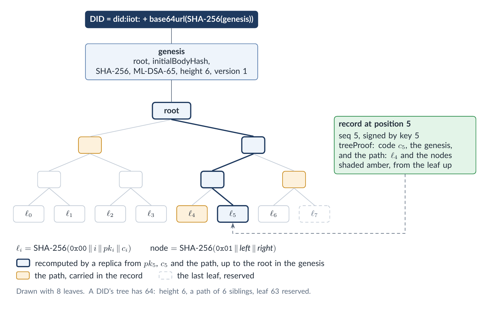
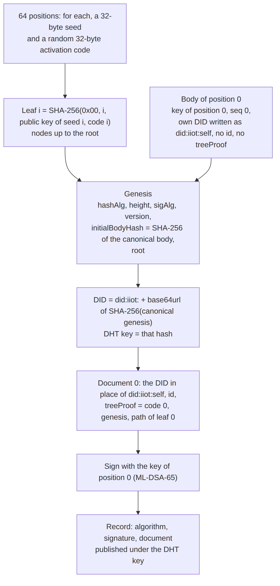

# Integration guide

This guide is for developers of applications that create, rotate, publish and
resolve `did:iiot` identifiers with AuthKademlia-RS, from Python or from Rust.
It states what the application must do for the guarantees of
[DESIGN.md](../DESIGN.md) to hold; DESIGN.md explains why.

## Contents

1. [Responsibilities](#1-responsibilities)
2. [Running a node](#2-running-a-node)
3. [Record format](#3-record-format)
4. [Creating a DID](#4-creating-a-did)
5. [Publishing a record](#5-publishing-a-record)
6. [Rotating the key](#6-rotating-the-key)
7. [Republishing](#7-republishing)
8. [Resolving a DID](#8-resolving-a-did)
9. [Key custody](#9-key-custody)
10. [The Status List](#10-the-status-list)
11. [Migrating from UUID-based DIDs](#11-migrating-from-uuid-based-dids)

## 1. Responsibilities

| The node | The application |
|---|---|
| Checks the form of every record, its key against the tree its DID commits to, and its signature | Builds the tree, the genesis and documents in canonical form, and computes the DID |
| Keeps one record per DID, replaced by any verified higher position | Keeps the seeds and activation codes in protected storage, and releases a code only with its position |
| Before an empty replica stores a record, looks for a node that shows a higher one | Signs each position once, saves it, and resends the saved bytes on every retry |
| Republishes the records it holds every hour, and takes a higher one a replica shows | Never reuses a position: saves the highest one activated before publishing it |
| Returns a verified record on a read, and on request fetches the one a credential names | Republishes its current record at least once every 24 hours, and decides whether the key it reads is trusted |

## 2. Running a node

Build the Python module with `maturin develop --features python` (see the
[README](../README.md#python)). Every method of `Server` returns a coroutine.

```python
import authkademlia_py

async def start(port: int, seeds: list[tuple[str, int]]) -> authkademlia_py.Server:
    node = authkademlia_py.Server(ksize=20, alpha=3, sig_cache=True)
    await node.listen(port, "0.0.0.0")
    await node.bootstrap(seeds)
    return node
```

- Use the same `ksize` and `alpha` on every node of a network: replica sets
  and the Status List quorum derive from them.
- `sig_cache=True` keeps the results of signature verifications for an hour;
  it pays off when the same records are read repeatedly.
- `data_dir="/var/lib/dht"` keeps the records the node holds on disk, so that
  after a power cut it serves them again, with the rest of their TTL, before
  any other node answers. A new record is on disk before the node
  acknowledges it; renewed expiries are written every `flush_secs` (3600 by
  default). Without `data_dir` a restarted node is empty until other nodes
  send it its records. On a device, prefer a persistent directory.
- `issuer_path` is needed only on nodes that verify the Status List
  ([section 10](#10-the-status-list)).
- Signature verification releases the GIL and runs on every core.
- `await node.stop()` notifies the neighbours and releases the socket.
- `await node.stats()` returns the size of the routing table, the storage use
  and the signature cache entries.

A Rust application uses `auth_kademlia_rs::network::Server` with the same
operations, inside a Tokio runtime whose blocking pool is bounded by the
number of cores, as [`examples/publish_did.rs`](../examples/publish_did.rs)
shows. There the owner's side of section 4 is
`auth_kademlia_rs::auth_handler::owner::OwnerTree`, which generates the
secrets, gives the genesis and signs the record of a position; the formats
are in `auth_handler::tree` (`Tree`, `Genesis`, `document_at`) and
`auth_handler::did` (`canonical_bytes`, `key_of_did`).

## 3. Record format

A record is the signed DID Document, prefixed by its algorithm and signature:

```
| algorithm (12 bytes: "ML-DSA-65", NUL-padded) | signature (3309 bytes) | DID Document |
```

The signature is ML-DSA-65 over the document bytes, by the key the document
declares. That key must be the one the DID commits to at the document's
position: every DID commits, through its genesis, to a Merkle tree of 64
leaves, and leaf `i` holds the key and a random 32-byte activation code of
position `i`. Positions 0 to 62 sign documents; 63 is reserved. A node
refuses as invalid any record that breaks one of the following
requirements.



**Fields.**

| Field | Content |
|---|---|
| `id` | The DID. It never changes. |
| `verificationMethod[0].publicKeyJwk` | The key of the position: `{"kty": "AKP", "alg": "ML-DSA-65", "pub": <base64url of the 1952-byte raw public key>}`. `MlDsaKeyManager.get_jose_format(public_key)` returns it. |
| `seq` | The position, from 0 to 62. Positions need not follow each other: after 2 the owner may publish 5. |
| `prev` | Absent at position 0. After it, the base64url SHA-256 of the whole record the owner published before. Nodes check only its form. |
| `treeProof` | Exactly three members: `code`, the activation code of the position (43 characters); `genesis`, the object whose hash is the DID; `path`, the six sibling hashes from the leaf to the root (192 bytes, 256 characters). |

The genesis holds exactly `hashAlg` (`"SHA-256"`), `height` (6),
`initialBodyHash`, `root`, `sigAlg` (`"ML-DSA-65"`) and `version` (1).
`initialBodyHash` is the SHA-256 of the body of position 0: its document
without `id` and `treeProof`, with the placeholder `did:iiot:self` wherever
the DID appears. Base64url is always without padding; a hash is 43
characters.

**Canonical form.** The document bytes must be exactly those of
`json.dumps(doc, sort_keys=True, separators=(",", ":"))`:

- keys and strings in printable ASCII only (from space to `~`);
- integers within ±(2^53 − 1), and no floating-point numbers;
- keys sorted, no whitespace.

A signed document must not contain the placeholder `did:iiot:self`, which
only bodies use.

**Reference helpers.** The following functions use only the Python standard
library. They give the root, the initial body hash and the DID of the test
vector in `src/auth_handler/tree.rs`
(`the_python_test_vector_gives_the_same_did`).

```python
import base64
import hashlib
import json

PLACEHOLDER = "did:iiot:self"
MAX_INTEGER = 2**53 - 1
ALGORITHM = b"ML-DSA-65".ljust(12, b"\0")
SIGNATURE_LEN = 3309
HEIGHT = 6
POSITIONS = 2**HEIGHT     # 0 to 62 sign documents
RESERVED = POSITIONS - 1  # 63 is never used


def b64(raw: bytes) -> str:
    return base64.urlsafe_b64encode(raw).rstrip(b"=").decode()


def sha256(raw: bytes) -> bytes:
    return hashlib.sha256(raw).digest()


def _check(value) -> None:
    printable = lambda s: all(0x20 <= ord(c) <= 0x7E for c in s)
    if isinstance(value, bool) or value is None:
        return
    if isinstance(value, int):
        if abs(value) > MAX_INTEGER:
            raise ValueError("integer beyond 2^53 - 1")
    elif isinstance(value, str):
        if not printable(value):
            raise ValueError("character outside printable ASCII")
    elif isinstance(value, list):
        for item in value:
            _check(item)
    elif isinstance(value, dict):
        for key, item in value.items():
            if not isinstance(key, str) or not printable(key):
                raise ValueError("key outside printable ASCII")
            _check(item)
    else:
        raise ValueError(f"no canonical form for {type(value).__name__}")


def canonical(doc: dict) -> bytes:
    """The bytes every node expects: sorted keys, no whitespace."""
    _check(doc)
    return json.dumps(doc, sort_keys=True, separators=(",", ":")).encode()


def replace_did(value, old: str, new: str):
    """Replace `old` by `new` in every string value that is `old` or a DID URL
    of it (`old#...`, `old?...`, `old/...`). Object keys are left unchanged."""
    if isinstance(value, str):
        if value == old or (value.startswith(old) and value[len(old)] in "#?/"):
            return new + value[len(old):]
        return value
    if isinstance(value, list):
        return [replace_did(item, old, new) for item in value]
    if isinstance(value, dict):
        return {key: replace_did(item, old, new) for key, item in value.items()}
    return value


def leaf(position: int, public_key: bytes, code: bytes) -> bytes:
    return sha256(b"\x00" + position.to_bytes(4, "big") + public_key + code)


def node(left: bytes, right: bytes) -> bytes:
    return sha256(b"\x01" + left + right)


def tree(leaves: list[bytes]) -> list[list[bytes]]:
    """Every level of the tree, from the 64 leaves up to the root."""
    levels = [leaves]
    while len(levels[-1]) > 1:
        below = levels[-1]
        levels.append([node(below[n], below[n + 1]) for n in range(0, len(below), 2)])
    return levels


def path(levels: list[list[bytes]], position: int) -> bytes:
    """The 192-byte membership path of a position: its sibling at each level,
    the leaf's sibling first."""
    siblings = b""
    for level in levels[:HEIGHT]:
        siblings += level[position ^ 1]
        position //= 2
    return siblings


def genesis(initial_body_hash: bytes, root: bytes) -> dict:
    return {
        "hashAlg": "SHA-256",
        "height": HEIGHT,
        "initialBodyHash": b64(initial_body_hash),
        "root": b64(root),
        "sigAlg": "ML-DSA-65",
        "version": 1,
    }


def did_of(genesis: dict) -> str:
    return "did:iiot:" + b64(sha256(canonical(genesis)))


def body(public_key: bytes, seq: int, previous_record: bytes | None = None,
         services=()) -> dict:
    """The body of position `seq`: its own DID written as the placeholder,
    no `id`, no `treeProof`."""
    doc = {
        "@context": ["https://www.w3.org/ns/did/v1"],
        "verificationMethod": [{
            "id": PLACEHOLDER + "#k0",
            "type": "JsonWebKey2020",
            "controller": PLACEHOLDER,
            "publicKeyJwk": {"kty": "AKP", "alg": "ML-DSA-65", "pub": b64(public_key)},
        }],
        "authentication": [PLACEHOLDER + "#k0"],
        "service": list(services),
        "seq": seq,
    }
    if previous_record is not None:
        doc["prev"] = b64(sha256(previous_record))
    return doc


def document(body: dict, genesis: dict, code: bytes, path: bytes) -> dict:
    """The document to sign: the DID in place of the placeholder, `id`, and
    `treeProof` with the genesis, the code and the path of the position."""
    did = did_of(genesis)
    doc = replace_did(body, PLACEHOLDER, did)
    doc["id"] = did
    doc["treeProof"] = {"code": b64(code), "genesis": genesis, "path": b64(path)}
    return doc


def signed_record(key_manager, private_key: bytes, doc: dict) -> bytes:
    data = canonical(doc)
    return ALGORITHM + key_manager.sign(private_key, data) + data


def parse_record(record: bytes):
    algorithm = record[:12].rstrip(b"\0").decode()
    signature = record[12:12 + SIGNATURE_LEN]
    doc = json.loads(record[12 + SIGNATURE_LEN:])
    return algorithm, signature, doc
```

Services are written with the placeholder (`did:iiot:self#device`):
`document` puts the DID in its place.

## 4. Creating a DID

The DID is the hash of the genesis, so it fixes the body of position 0 and
every key and code of the tree. Nothing about a DID can be added to the
tree later.



```python
import secrets

key_manager = authkademlia_py.MlDsaKeyManager("keys")

# 64 seeds and 64 codes, kept in protected storage.
seeds = [secrets.token_bytes(32) for _ in range(POSITIONS)]
codes = [secrets.token_bytes(32) for _ in range(POSITIONS)]
public_keys = [key_manager.keypair_from_seed(seed)[0] for seed in seeds]
levels = tree([leaf(i, public_keys[i], codes[i]) for i in range(POSITIONS)])

services = [{
    "id": PLACEHOLDER + "#device",
    "type": "DeviceAgent",
    "serviceEndpoint": "https://device.example/agent",
}]
initial = body(public_keys[0], 0, services=services)
tree_genesis = genesis(sha256(canonical(initial)), levels[-1][0])
did = did_of(tree_genesis)

_, private_key = key_manager.keypair_from_seed(seeds[0])
doc = document(initial, tree_genesis, codes[0], path(levels, 0))
record_0 = signed_record(key_manager, private_key, doc)
```

1. Generate a random seed and a random activation code for each of the 64
   positions, the reserved one included: its leaf completes the tree. Derive
   each public key from its seed and compute the leaves and the root.
2. Write the body of position 0 with every field except `id` and
   `treeProof`, and the placeholder `did:iiot:self` wherever the document
   refers to its own DID.
3. Build the genesis from the hash of that body and the root. The DID is
   `did:iiot:` followed by the base64url SHA-256 of the canonical genesis;
   the DHT key is the hash itself.
4. Complete the document with the DID, `id` and `treeProof`, and sign it
   with the key of position 0.
5. **Save before sending:** the DID, the genesis, `record_0` as the
   published record, position 0 as the highest activated, and the seeds and
   codes in protected storage ([section 9](#9-key-custody)).

`keypair_from_seed` gives the same key pair for the same 32-byte seed, so
the application keeps only seeds, never private keys.

## 5. Publishing a record

Every position, the first included, is published with the same call:

```python
result = await node.set_detailed(did, record)
```

`result["status"]` is `complete`, `degraded` or `rejected`; `result["reason"]`
explains a rejection, and `result["report"]` counts the answers of the
replicas (`expected_replicas`, `acknowledged_replicas`, `unavailable_nodes`,
`conflict_rejections`, `stale_rejections`, `unproven_refusals`, and others).
A replica that refuses the record counts only once it shows why:
`set_detailed` asks it for its record, checks that it proves the refusal and
verifies it. A refusal it cannot back up only means that replica did not
store the record, and is counted in `unproven_refusals`.

| Outcome | Meaning | Action |
|---|---|---|
| `complete` | Every replica that answered holds the record | None |
| `degraded` | Some replicas did not acknowledge it, or refused it without showing why | Retry later with the same bytes |
| `rejected`, `unavailable`, `no_responsible_nodes` or `capacity_exceeded` | No replica took it | Retry later with the same bytes |
| `rejected`, `invalid_record` | The record does not verify for the DID, so it never left the node; or no replica stored it and replicas called it invalid | Fix the construction of the document |
| `rejected`, `existing_record` | A replica showed another valid record at this position | If the application signed this position twice, publish only the saved record. Otherwise the key of this position has leaked: see [section 9](#9-key-custody) |
| `rejected`, `newer_version` | A replica showed a valid record of this DID at a higher position | If the application published it and its saved state is behind, raise the highest activated position to it and go on from there. Otherwise the keys and codes of the tree have leaked, and the device needs a new DID |
| `rejected`, `replica_conflict` | No replica stored it, and those that refused showed nothing to back up the refusal | Retry later with the same bytes; if it persists, a node near the DID may be lying |

`set(did, record)` is the short form: `True` for complete, `False` for
degraded or unavailable, `None` for a rejected record.

A retry with byte-identical data is always safe: a replica that already holds
it answers that it does. Never sign a position again to retry: FIPS 204
makes randomized signing the default, so a second signature of the same
document is a different record, which replicas refuse as a conflict.

## 6. Rotating the key

A rotation publishes a higher position, signed by its own key. A replica
checks that key against the tree and replaces the lower position it holds;
it needs no record in between, and the owner sends nothing else. A change of
services or endpoints is also a rotation.

```python
async def rotate(node, key_manager, state, position, services):
    """Publish `position`, above every position activated so far."""
    if position <= state.highest or position >= RESERVED or position in state.skipped:
        raise ValueError("position not available")
    state.highest = position
    state.save()                      # durably, before the record exists
    public_key, private_key = key_manager.keypair_from_seed(state.seeds[position])
    draft = body(public_key, position, previous_record=state.published,
                 services=services)
    doc = document(draft, state.genesis, state.codes[position],
                   path(state.levels, position))
    state.pending = signed_record(key_manager, private_key, doc)
    state.save()                      # before sending it
    result = await node.set_detailed(state.did, state.pending)
    if result["status"] != "rejected":
        state.published, state.pending = state.pending, None
        state.save()
    return result
```

The order of the steps makes the rotation safe across a crash:

1. Pick the position: the one due by the schedule, above the highest
   activated, never a skipped one nor 63.
2. Save it as the highest activated position, with a write the operating
   system has flushed to storage, before the record is signed.
3. Build its body with `seq` the position and `prev` the hash of the record
   published before, and complete it with that position's code and path.
4. Sign it once and save the record as pending.
5. Publish it with `set_detailed`. Once a replica holds it, it is the
   published record, and a degraded publication is completed by
   republication ([section 7](#7-republishing)). Rejected because no replica
   took it, it stays pending and is retried with the same bytes.

After a restart, a pending record is sent again from the saved bytes and is
never signed again, and the highest activated position never goes back,
even if the clock does.

**Schedule.** Rotation is periodic: from a start time `T`, every interval
`D`, the position due is `floor((now - T) / D)`. The interval is a
deployment choice, a week or a month. After an outage the device publishes
the position due directly: back in the slot of 5 after publishing 2, it
publishes 5 with `prev` naming record 2, and the codes of 3 and 4 are never
released. A position may also be published before its slot when the current
key has leaked ([section 9](#9-key-custody)): the position due is then the
greater of the schedule's index and the highest activated position, so the
next one is due at its normal time.

When position 62 has been published the tree is exhausted: the device needs
a new DID.

## 7. Republishing

At least once every 24 hours, and whenever the device comes back online,
send the published record again with the saved bytes:

```python
await node.set_detailed(state.did, state.published)
```

Replicas holding the record republish it every hour, and an empty replica
stores a verified record unless a node shows it a higher one, so replicas
that lose their copy get it back from the others. The owner's republication
restores the copies when no replica is left to send them. A copy that nobody
sends again expires after 14 days.

Nodes keep only the current record, and so does the owner: the records
before it are needed neither for retries nor by any replica.

## 8. Resolving a DID

```python
record = await node.get(did)              # bytes, or None
if record is not None:
    algorithm, signature, doc = parse_record(record)
    public_key = doc["verificationMethod"][0]["publicKeyJwk"]["pub"]
    position = doc["seq"]
```

A record returned by `get` is one the owner signed: its key is the one its
DID commits to at its position, and its signature verifies. It is not proof
that the position is the current one: a replica can be behind, and an empty
replica that saw no higher position stores the record it is offered. The
application decides whether to trust the key, for example by comparing it
with the key bound in the device's Verifiable Credential. That protects
against a superseded record only if the credential of a superseded key is
revoked, or expires, at rotation.

A node that holds a copy serves it without asking the network, so a node
that missed a rotation keeps serving the old position. When the key fails
the credential and the credential names a higher position, ask the node to
repair its copy:

```python
repaired = await node.repair(did, record, expected_seq, sha256(expected_key))
```

`expected_seq` and `expected_key`, the raw public key, come from the
credential the application has checked. The node looks in the network for
that record, for at most 5 seconds, verifies it, and stores it in place of
the old one: the next `get` serves it locally. `repair` returns the record,
or `None` when no node showed it, or when a higher position than the expected
one turned up, which means the credential is itself out of date. A `get`
never stores what it finds; only `repair` does, because the application has
checked what it asked for.

Accept a DID from outside only in canonical form: `did:iiot:` followed by 43
base64url characters that decode to 32 bytes and encode back to the same
text. Python's `base64.urlsafe_b64decode` accepts non-canonical trailing bits,
so compare the re-encoding:

```python
def is_canonical_did(did: str) -> bool:
    suffix = did.removeprefix("did:iiot:")
    if suffix == did or len(suffix) != 43:
        return False
    try:
        raw = base64.urlsafe_b64decode(suffix + "=")
    except ValueError:
        return False
    return len(raw) == 32 and b64(raw) == suffix
```

## 9. Key custody

- **The seeds and codes** of the 64 positions are the DID's secrets. Keep
  them in a secure element, TPM, TEE or HSM where the device has one, and
  derive a key pair only to sign its position. A copy of all of them gives
  every future position to whoever holds it.
- **A code stays private** until the record of its position is published;
  the record makes it public.
- **After a rotation**, once the new position is published and its
  credential issued, erase the seeds below it. Retries resend saved bytes and
  need no key.
- **A stolen current key** cannot sign a higher position, which needs that
  position's key and its unreleased code. It can sign another document at
  the current position, whose code is public: replicas holding the genuine
  one refuse it, but an empty replica may store it. Publish the next
  position at once, even before its slot, and have the credential of the
  stolen key revoked. When and with what authorization to rotate early is
  the application's decision, typically signed by the issuer, which issues
  the new credential; the nodes never see it.
- **A leaked seed of a future position**: skip that position for good,
  across restarts, and never release its code.
- **Lost seeds and codes**: no further rotation is possible, and the device
  needs a new DID.

## 10. The Status List

The issuer publishes the revocation list under the key `status-list`, signed
with the issuer key whose raw ML-DSA-65 public key nodes read from the file
passed as `issuer_path`:

```python
await node.set("status-list", signed_list)            # the first list
await node.update_status_list(signed_list)            # every later one
status_list = await node.get("status-list")
```

`update_status_list` returns `True` when a strict majority of the replicas
took the list, `False` otherwise, and `None` when no list is published yet or
the signature does not verify. A read of the Status List requires two
byte-identical answers (with `alpha` = 3). The list carries no version yet, so
nodes accept any list the issuer signed, an older one included
([DESIGN.md](../DESIGN.md), "Status List").

## 11. Migrating from UUID-based DIDs

This release changes the format of DIDs, of documents and of the messages
between nodes. Nodes of earlier releases cannot exchange messages with nodes
of this one, so a network is upgraded as a whole. Records published before
cannot be carried over: each device creates a new DID, and credentials bound
to the old one are issued again.

| Before | Now |
|---|---|
| `did:iiot:<UUID>`; the DHT key is the SHA-256 of the UUID | `did:iiot:<SHA-256 of the genesis>`; the DHT key is the decoded hash |
| Documents without `seq`, `prev` and `treeProof` | Canonical JSON, checked by every node, with `seq` (the position), `prev` after position 0, and `treeProof` |
| `update(key, value, auth_signature)`, the new record signed again with the old key | `set(did, record)` for every position: the tree authorizes the key of each position |
| `set_detailed` report without stale counts | `stale_rejections` and `unproven_refusals`; reason `newer_version`; `existing_record` only when a replica shows another record at the same position |
| `update("status-list", value, None)` | `update_status_list(value)` |
| `Ed25519KeyManager` | Removed: records are signed with ML-DSA-65 only |
| — | `MlDsaKeyManager.keypair_from_seed(seed)` |

The application now keeps the seeds and codes of its tree, the published
record and the highest activated position, and republishes at least once
every 24 hours.
