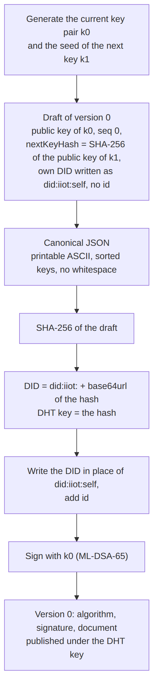
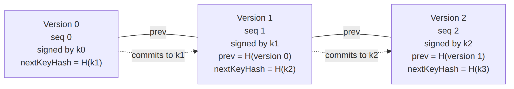

# Integration guide

This guide is for developers of applications that create, rotate, publish and
resolve `did:iiot` identifiers with AuthKademlia-RS, from Python or from Rust.
It states what the application must do for the guarantees of
[DESIGN.md](../DESIGN.md) to hold; DESIGN.md explains why.

## Contents

1. [Responsibilities](#1-responsibilities)
2. [Running a node](#2-running-a-node)
3. [Record format](#3-record-format)
4. [Creating a DID](#4-creating-a-did)
5. [Publishing the first version](#5-publishing-the-first-version)
6. [Rotating the key](#6-rotating-the-key)
7. [Keeping the chain and republishing](#7-keeping-the-chain-and-republishing)
8. [Resolving a DID](#8-resolving-a-did)
9. [Key custody](#9-key-custody)
10. [The Status List](#10-the-status-list)
11. [Migrating from UUID-based DIDs](#11-migrating-from-uuid-based-dids)

## 1. Responsibilities

| The node | The application |
|---|---|
| Checks the form, the binding to the DID and the signature of every record | Builds DID Documents in canonical form and computes the DID |
| Applies the rules of each replica: keeps one version, replaced only by its verified successor | Generates the keys and keeps the seed of the next one in protected storage |
| Checks the network before an empty replica stores a record | Signs each version once, saves it, and resends the saved bytes on every retry |
| Replays the owner's chain to replicas that miss versions | Keeps every version it has published |
| Republishes the records it holds every hour | Republishes its own record at least once every 24 hours |
| Returns a verified record on a read | Decides whether the key it reads is trusted |

## 2. Running a node

Build the Python module with `maturin develop --features python` (see the
[README](../README.md#python)). Every method of `Server` returns a coroutine.

```python
import authkademlia_py

async def start(port: int, seeds: list[tuple[str, int]]) -> authkademlia_py.Server:
    node = authkademlia_py.Server(ksize=20, alpha=3, sig_cache=True)
    await node.listen(port, "0.0.0.0")
    await node.bootstrap(seeds)
    return node
```

- Use the same `ksize` and `alpha` on every node of a network: replica sets
  and quorums derive from them.
- `sig_cache=True` keeps the results of signature verifications for an hour;
  it pays off when the same records are read repeatedly.
- `issuer_path` is needed only on nodes that verify the Status List
  ([section 10](#10-the-status-list)).
- Signature verification releases the GIL and runs on every core.
- `await node.stop()` notifies the neighbours and releases the socket.
- `await node.stats()` returns the size of the routing table, the storage use
  and the signature cache entries.

A Rust application uses `auth_kademlia_rs::network::Server` with the same
operations, inside a Tokio runtime whose blocking pool is bounded by the
number of cores, as [`examples/publish_did.rs`](../examples/publish_did.rs)
shows. The DID helpers of section 4 are available in Rust as
`auth_kademlia_rs::auth_handler::did` (`derive_did`, `canonical_bytes`,
`key_of_did`).

## 3. Record format

A record is the signed DID Document, prefixed by its algorithm and signature:

```
| algorithm (12 bytes: "ML-DSA-65", NUL-padded) | signature (3309 bytes) | DID Document |
```

The signature is ML-DSA-65 over the document bytes, by the key the document
itself declares. A node refuses as invalid any record that breaks one of the
following requirements.

**Fields.**

| Field | Content |
|---|---|
| `id` | The DID. It never changes. |
| `verificationMethod[0].publicKeyJwk` | The key that signs this version: `{"kty": "AKP", "alg": "ML-DSA-65", "pub": <base64url of the 1952-byte raw public key>}`. `MlDsaKeyManager.get_jose_format(public_key)` returns it. |
| `seq` | 0 for the first version, then one more for each version. |
| `prev` | Absent in version 0. In version N, the base64url SHA-256 of the whole record of version N−1. |
| `nextKeyHash` | The base64url SHA-256 of the raw public key that will sign the next version. It may not be the hash of the document's own key. |

Base64url is always without padding; a hash is 43 characters.

**Canonical form.** The document bytes must be exactly those of
`json.dumps(doc, sort_keys=True, separators=(",", ":"))`:

- keys and strings in printable ASCII only (from space to `~`);
- integers within ±(2^53 − 1), and no floating-point numbers;
- keys sorted, no whitespace.

A document must not contain the placeholder `did:iiot:self`, which only
drafts of version 0 use.

**Reference helpers.** The following functions use only the Python standard
library. They give the DID of the test vector in
`src/auth_handler/did.rs` (`the_python_test_vector_gives_the_same_did`).

```python
import base64
import hashlib
import json

PLACEHOLDER = "did:iiot:self"
MAX_INTEGER = 2**53 - 1
ALGORITHM = b"ML-DSA-65".ljust(12, b"\0")
SIGNATURE_LEN = 3309


def b64(raw: bytes) -> str:
    return base64.urlsafe_b64encode(raw).rstrip(b"=").decode()


def sha256(raw: bytes) -> bytes:
    return hashlib.sha256(raw).digest()


def _check(value) -> None:
    printable = lambda s: all(0x20 <= ord(c) <= 0x7E for c in s)
    if isinstance(value, bool) or value is None:
        return
    if isinstance(value, int):
        if abs(value) > MAX_INTEGER:
            raise ValueError("integer beyond 2^53 - 1")
    elif isinstance(value, str):
        if not printable(value):
            raise ValueError("character outside printable ASCII")
    elif isinstance(value, list):
        for item in value:
            _check(item)
    elif isinstance(value, dict):
        for key, item in value.items():
            if not isinstance(key, str) or not printable(key):
                raise ValueError("key outside printable ASCII")
            _check(item)
    else:
        raise ValueError(f"no canonical form for {type(value).__name__}")


def canonical(doc: dict) -> bytes:
    """The bytes every node expects: sorted keys, no whitespace."""
    _check(doc)
    return json.dumps(doc, sort_keys=True, separators=(",", ":")).encode()


def replace_did(value, old: str, new: str):
    """Replace `old` by `new` in every string value that is `old` or a DID URL
    of it (`old#...`, `old?...`, `old/...`). Object keys are left unchanged."""
    if isinstance(value, str):
        if value == old or (value.startswith(old) and value[len(old)] in "#?/"):
            return new + value[len(old):]
        return value
    if isinstance(value, list):
        return [replace_did(item, old, new) for item in value]
    if isinstance(value, dict):
        return {key: replace_did(item, old, new) for key, item in value.items()}
    return value


def document(did, public_key, seq, next_public_key, previous_record=None, services=()):
    """One version of a DID Document, without `id`."""
    doc = {
        "@context": ["https://www.w3.org/ns/did/v1"],
        "verificationMethod": [{
            "id": did + "#k0",
            "type": "JsonWebKey2020",
            "controller": did,
            "publicKeyJwk": {"kty": "AKP", "alg": "ML-DSA-65", "pub": b64(public_key)},
        }],
        "authentication": [did + "#k0"],
        "service": [replace_did(s, PLACEHOLDER, did) for s in services],
        "seq": seq,
        "nextKeyHash": b64(sha256(next_public_key)),
    }
    if previous_record is not None:
        doc["prev"] = b64(sha256(previous_record))
    return doc


def derive_did(draft: dict):
    """The DID of a draft of version 0, and the document to sign."""
    did = "did:iiot:" + b64(sha256(canonical(draft)))
    doc = replace_did(draft, PLACEHOLDER, did)
    doc["id"] = did
    return did, doc


def signed_record(key_manager, private_key: bytes, doc: dict) -> bytes:
    body = canonical(doc)
    return ALGORITHM + key_manager.sign(private_key, body) + body


def parse_record(record: bytes):
    algorithm = record[:12].rstrip(b"\0").decode()
    signature = record[12:12 + SIGNATURE_LEN]
    doc = json.loads(record[12 + SIGNATURE_LEN:])
    return algorithm, signature, doc
```

The services may be written with the placeholder (`did:iiot:self#device`):
`document` puts the DID in their place.

## 4. Creating a DID

The DID is the hash of the first version of the document, so it is fixed by
the first key, the hash of the second key and every other field of that
version.



```python
import secrets

key_manager = authkademlia_py.MlDsaKeyManager("keys")

current_seed = secrets.token_bytes(32)
next_seed = secrets.token_bytes(32)      # kept in protected storage
public_key, private_key = key_manager.keypair_from_seed(current_seed)
next_public_key, _ = key_manager.keypair_from_seed(next_seed)

services = [{
    "id": PLACEHOLDER + "#device",
    "type": "DeviceAgent",
    "serviceEndpoint": "https://device.example/agent",
}]
draft = document(PLACEHOLDER, public_key, 0, next_public_key, services=services)
did, doc = derive_did(draft)
record_0 = signed_record(key_manager, private_key, doc)
```

1. Generate the current key and the seed of the next key.
2. Write the first version with every field except `id`, and the placeholder
   `did:iiot:self` wherever the document refers to its own DID.
3. Hash its canonical bytes: the DID is `did:iiot:` followed by the
   base64url of the hash. The DHT key is the hash itself.
4. Put the DID in place of the placeholder, add `id`, and sign.
5. **Save before sending:** the DID, `record_0`, the current key, and the
   next seed in protected storage ([section 9](#9-key-custody)).

`keypair_from_seed` gives the same key pair for the same 32-byte seed, so the
application needs to keep only the seed of the next key.

## 5. Publishing the first version

```python
result = await node.set_detailed(did, record_0)
```

`result["status"]` is `complete`, `degraded` or `rejected`; `result["reason"]`
explains a rejection, and `result["report"]` counts the answers of the
replicas (`expected_replicas`, `acknowledged_replicas`, `unavailable_nodes`,
`conflict_rejections`, `stale_rejections`, `newer_claimed`, and others).

| Outcome | Meaning | Action |
|---|---|---|
| `complete` | Every replica that answered holds the record | None |
| `degraded` | Some replicas did not acknowledge it | Retry later with the same bytes |
| `rejected`, `unavailable`, `no_responsible_nodes` or `capacity_exceeded` | No replica took it | Retry later with the same bytes |
| `rejected`, `invalid_record` | The record is malformed or does not bind to the DID | Fix the construction of the document |
| `rejected`, `existing_record` or `replica_conflict` | Another record is held under this DID | Version 0 was signed twice: publish the saved record only |
| `rejected`, `newer_version` | Replicas hold or report a later version | Publish the current version with `update` |
| `rejected`, `use_update` | The record is not a version 0 | Use `update` |

`set(did, record)` is the short form: `True` for complete, `False` for
degraded or unavailable, `None` for a rejected record.

A retry with byte-identical data is always safe: a replica that already holds
it answers that it does. Never sign version 0 again to retry: FIPS 204 makes
randomized signing the default, so a second signature of the same document
can be a different record, which replicas refuse as a conflict.

## 6. Rotating the key

Every new version is a key rotation: version N is signed by the key that
version N−1 committed to, and commits to a new one. A change of services
or endpoints is therefore also a rotation.



```python
async def rotate(node, key_manager, did, chain, next_seed, services):
    """`chain` holds the saved records of versions 0 to N-1."""
    seed_after = secrets.token_bytes(32)
    # Save seed_after in protected storage before signing anything with it.
    public_key, private_key = key_manager.keypair_from_seed(next_seed)
    public_key_after, _ = key_manager.keypair_from_seed(seed_after)
    doc = document(did, public_key, len(chain), public_key_after,
                   previous_record=chain[-1], services=services)
    doc["id"] = did
    record = signed_record(key_manager, private_key, doc)
    # Save `record` as the pending version before sending it.
    return await node.update(did, record, chain)
```

The order of the steps makes the rotation safe across a crash:

1. Generate the seed of the key after the next one, and save it.
2. Derive the committed key from the stored next seed.
3. Build version N with the same `id`, `seq` N, `prev` the hash of the saved
   record of version N−1, the committed key, and the hash of the new next key.
4. Sign it once and save the record as the pending version.
5. Send it with `update(did, record, earlier)`, where `earlier` holds the
   saved records of versions 0 to N−1.

After a restart, a pending version is sent again from the saved bytes and is
never signed again.

| `update` returns | Meaning | Action |
|---|---|---|
| `True` | A majority of the closest replicas holds version N | Add it to the chain; erase the previous private key |
| `False` | No majority yet | Keep it pending; retry later with the same arguments |
| `None` | Refused before sending: a version 0, a record that does not bind or verify, or `earlier` that is not its chain | Fix the saved chain; do not sign another version N |

`earlier` is used only to replay the chain to replicas that miss versions:
a replica behind receives the versions it lacks, one at a time, and an empty
replica receives the chain from version 0 when the network check allows it.
Passing fewer versions limits that replay.

A second, different version N signed by the same key is proof of duplicity:
replicas holding the first refuse the second and log it.

## 7. Keeping the chain and republishing

Keep every published version, about 6.5 KB each: with a rotation a week, a
year of versions is about 345 KB. Nodes hold only the current version.

At least once every 24 hours, and whenever the device comes back online,
send the current version again with the saved bytes:

```python
if len(chain) == 1:
    await node.set_detailed(did, chain[0])
else:
    await node.update(did, chain[-1], chain[:-1])
```

Replicas holding the record republish it every hour, but an empty replica
accepts a later version from them only when enough of the nodes it asks hold
it (13 with `k` = 20). Below that, only the owner can restore the copies:
[EXPERIMENTS.md](../EXPERIMENTS.md), L2, measures both cases. A copy that nobody
sends again expires after 14 days.

## 8. Resolving a DID

```python
record = await node.get(did)              # bytes, or None
if record is not None:
    algorithm, signature, doc = parse_record(record)
    public_key = doc["verificationMethod"][0]["publicKeyJwk"]["pub"]
```

A record returned by `get` binds to the DID and its signature verifies. It is
not proof that the version is the current one, nor that the key belongs to
the device: a replica can be behind, and a node can serve a later version
that it signed itself. The application decides whether to trust the key, for
example by comparing it with the key bound in the device's Verifiable
Credential.

Accept a DID from outside only in canonical form: `did:iiot:` followed by 43
base64url characters that decode to 32 bytes and encode back to the same
text. Python's `base64.urlsafe_b64decode` accepts non-canonical trailing bits,
so compare the re-encoding:

```python
def is_canonical_did(did: str) -> bool:
    suffix = did.removeprefix("did:iiot:")
    if suffix == did or len(suffix) != 43:
        return False
    try:
        raw = base64.urlsafe_b64decode(suffix + "=")
    except ValueError:
        return False
    return len(raw) == 32 and b64(raw) == suffix
```

## 9. Key custody

- **The current key** signs the current version and the device's
  authentications.
- **The next key** signs only the next version. Keep it as its 32-byte seed in
  a secure element, TPM, TEE or HSM where the device has one, and derive the
  key pair only at the rotation. Pre-rotation protects the DID only as far as
  the next seed is better protected than the current key.
- **After a confirmed rotation**, erase the previous private key. Retries do
  not need it: they resend saved bytes.
- **A seed suspected of having leaked**: rotate with it at once. There is no
  other way to change the commitment.
- **A lost next seed**: no further rotation is possible, and the device needs
  a new DID.
- **A stolen current key** cannot rotate. It can sign a competing version at
  the current `seq`, which replicas holding the genuine version refuse;
  [DESIGN.md](../DESIGN.md), section 13, describes the remaining exposure.

## 10. The Status List

The issuer publishes the revocation list under the key `status-list`, signed
with the issuer key whose raw ML-DSA-65 public key nodes read from the file
passed as `issuer_path`:

```python
await node.update("status-list", signed_list, [])
status_list = await node.get("status-list")
```

A read of the Status List requires two byte-identical answers (with
`alpha` = 3). The list carries no version yet, so nodes accept any list the
issuer signed, an older one included ([DESIGN.md](../DESIGN.md), section 10).

## 11. Migrating from UUID-based DIDs

This release changes the format of DIDs, of documents and of the messages
between nodes. Nodes of earlier releases cannot exchange messages with nodes
of this one, so a network is upgraded as a whole. Records published before
cannot be carried over: each device creates a new DID, and credentials bound
to the old one are issued again.

| Before | Now |
|---|---|
| `did:iiot:<UUID>`; the DHT key is the SHA-256 of the UUID | `did:iiot:<hash of version 0>`; the DHT key is the decoded hash |
| Documents without `seq`, `prev` and `nextKeyHash` | Canonical JSON, checked by every node, with `seq`, `prev` and `nextKeyHash` |
| `update(key, value, auth_signature)`, the new record signed again with the old key | `update(did, value, earlier)`: the chain authorizes the update, and every update rotates the key |
| `set` and `set_detailed` for any record | Only for version 0; later versions with `update` |
| `set_detailed` report without stale counts | `stale_rejections`, `newer_claimed`; reasons `newer_version` and `use_update` |
| `update("status-list", value, None)` | `update("status-list", value, [])` |
| — | `MlDsaKeyManager.keypair_from_seed(seed)` |

The application now keeps the chain of its versions and the seed of the next
key, and republishes at least once every 24 hours.
